# GameHub – Chi tiết các luồng hoạt động và logic xử lý

> Tài liệu mô tả **từng luồng** trong dự án: người dùng làm gì → app xử lý gì → server xử lý gì → kết quả ra sao.
> Mỗi luồng có **sơ đồ** (Mermaid, xem đẹp trên GitHub / VS Code) và **các bước bằng chữ** kèm file code.
> Đọc kèm: `TONG_QUAN_DU_AN.md` (tổng quan).

**Mục lục**
1. Khởi động app
2. Tài khoản: đăng ký, đăng nhập, khôi phục phiên, hết phiên, đăng xuất
3. Kết nối realtime và trạng thái online
4. Luồng chung khi chơi xong một ván (nộp điểm, hàng đợi offline)
5. Sudoku
6. Caro (chơi trên máy)
7. Rubik 3D
8. Xếp hình (Sliding, Jigsaw, PhaseShift)
9. Bảng xếp hạng
10. Đối kháng online
11. Xã hội: bạn bè, nhắn tin, thách đấu
12. Hồ sơ
13. Đường đi của một request trên server
14. Máy trạng thái (state machine) và bảng mã lỗi

---

## 1. Khởi động app (`frontend_new/lib/main.dart`)

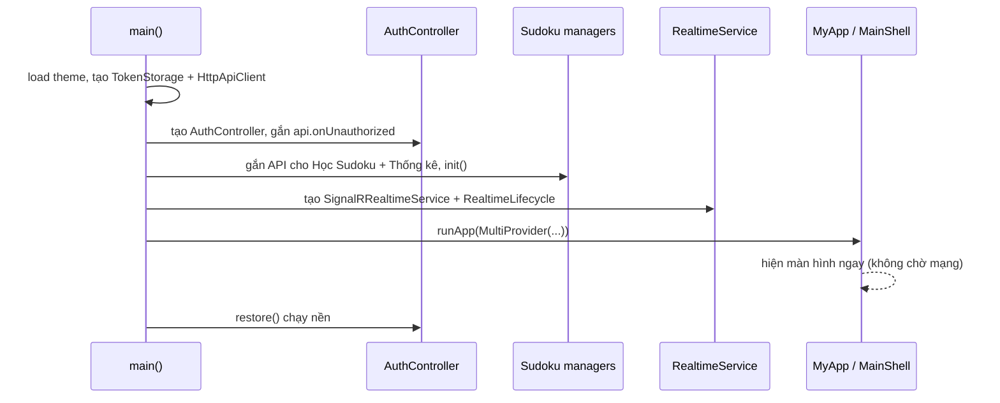

1. Nạp **chủ đề sáng/tối** đã lưu.
2. Tạo các đối tượng dùng chung cho cả app, đưa vào **Provider**: `ThemeController`, `ApiClient`, `AuthController`, `ScoreReporter`, `RealtimeService`, `MatchSession`.
3. Nối các "dây" giữa chúng:
   - API gặp **401** → `auth.handleUnauthorized` (xoá phiên).
   - Đổi tài khoản → Sudoku đổi dữ liệu theo người dùng (`switchUser`, `onUserChanged`).
   - Đăng nhập thành công → **gửi dần điểm đang xếp hàng** + đồng bộ Sudoku (`onSignedIn`).
   - Đăng xuất → `matchSession.reset()`.
4. `runApp` → `MainShell` (5 tab). `PvpNavigator` bọc ngoài toàn app: trận bắt đầu thì **tự mở màn trận**, có lời mời đấu thì **hiện hộp mời ở mọi màn hình**.
5. `auth.restore()` chạy **sau** khung hình đầu → app mở nhanh, không chờ mạng.
6. Tab **Xếp hạng** và **Bạn bè** chỉ dựng + gọi API khi được mở lần đầu (`shell/main_shell.dart`); các tab giữ trong `IndexedStack` nên chuyển tab không mất trạng thái.

---

## 2. Tài khoản

### 2.1 Đăng ký / đăng nhập

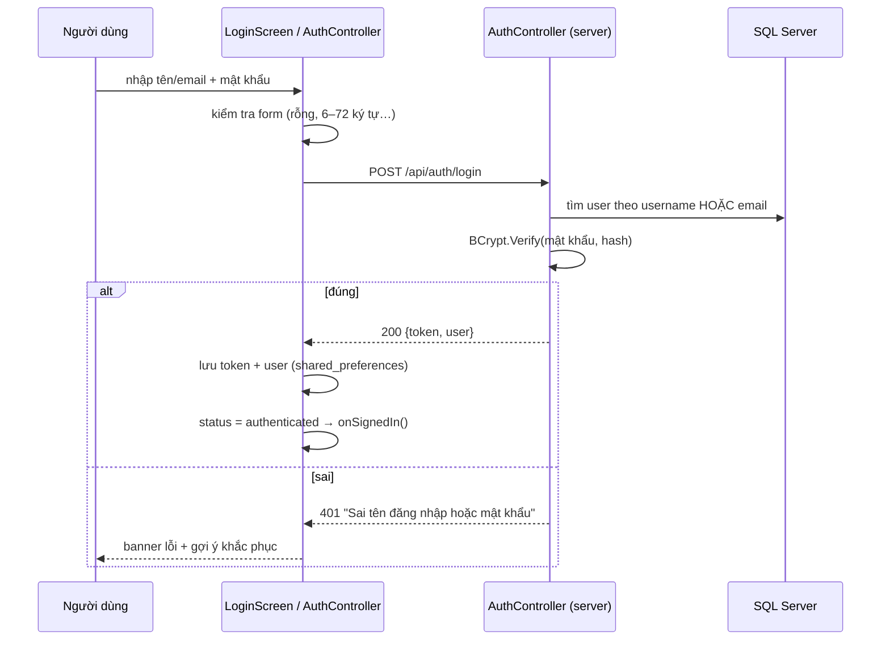
- Đăng ký giống vậy: `POST /api/auth/register` → kiểm tra trùng username/email (409) → `BCrypt.HashPassword` → trả luôn token (đăng ký xong là đăng nhập).
- Giới hạn **10 lần/phút/IP** cho cả hai.
- Sau khi có token: `RealtimeLifecycle` thấy đã đăng nhập → **kết nối SignalR**; `onSignedIn` → gửi điểm xếp hàng, đồng bộ Sudoku.

### 2.2 Khôi phục phiên khi mở app (`AuthController.restore`)
1. Không có token → trạng thái **khách** (vẫn chơi được, điểm chỉ tính tại máy).
2. Có token → gọi `GET /users/me`:
   - Thành công → cập nhật thông tin, **authenticated**.
   - **Mất mạng** → vẫn dùng thông tin người dùng đã lưu, đánh dấu `isOffline` (thẻ Hồ sơ hiện "Đang ngoại tuyến").
   - **401** (token hết hạn / tài khoản bị khoá) → xoá phiên, về khách.

### 2.3 Hết phiên giữa chừng
Bất kỳ request **có token** bị 401 → `ApiClient` gọi `onUnauthorized` → `AuthController.handleUnauthorized`: xoá token, chuyển về khách, hiện "Phiên đăng nhập đã hết hạn. Vui lòng đăng nhập lại."
> Vì vậy các lỗi "không phải lỗi phiên" (như sai mật khẩu cũ khi đổi mật khẩu) phải trả **400**, không được trả 401.

### 2.4 Đăng xuất
Hộp xác nhận → xoá token + user đã lưu → `RealtimeLifecycle` **ngắt SignalR** (bạn bè thấy mình offline) → `MatchSession.reset()` → Sudoku chuyển sang dữ liệu khách → các tab tải lại theo trạng thái khách.

---

## 3. Kết nối realtime và trạng thái online

### 3.1 Khi nào kết nối / ngắt (`core/realtime/realtime_lifecycle.dart`)
| Sự kiện | Hành động |
|---|---|
| Đăng nhập / khôi phục phiên thành công | Kết nối hub `/hubs/game` (token qua `access_token`) |
| Đăng xuất | Ngắt |
| App ở **nền quá 2 phút** | Ngắt (đỡ pin; bạn bè thấy offline) |
| App quay lại trước | Kết nối lại |

### 3.2 Tự kết nối lại (`realtime_service.dart`)
Mất kết nối → trạng thái `reconnecting` → thử lại sau **0 → 2 → 5 → 10 → 30 giây** (rồi cứ 30 giây). Nối lại được sau một lần mất → phát `reconnected` → `MatchSession` tự gọi **`Rejoin`** nếu đang trong trận.

### 3.3 Online / offline (`PresenceService.cs`)

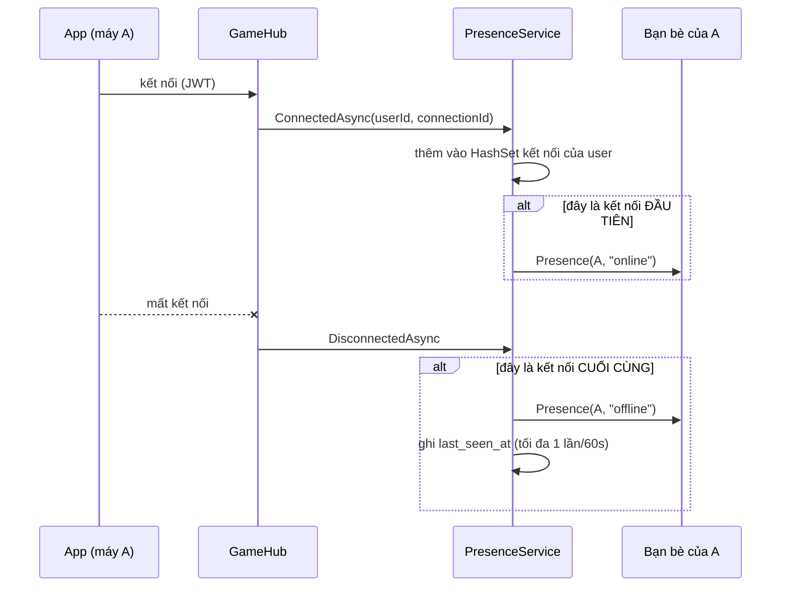
- Một người có thể mở app trên **nhiều máy**: chỉ khi **kết nối cuối cùng** đóng mới tính là offline.
- Vào / ra trận → `MatchService.InMatchChanged` → phát trạng thái **`in_match`**.
- Chỉ **bạn bè đã chấp nhận** nhận được thông báo trạng thái.

---

## 4. Luồng chung khi chơi xong một ván

Mọi trò chơi đơn (Sudoku, Caro đấu máy, Rubik, Sliding, Jigsaw, Toán Chéo) đều kết thúc bằng cùng một luồng:

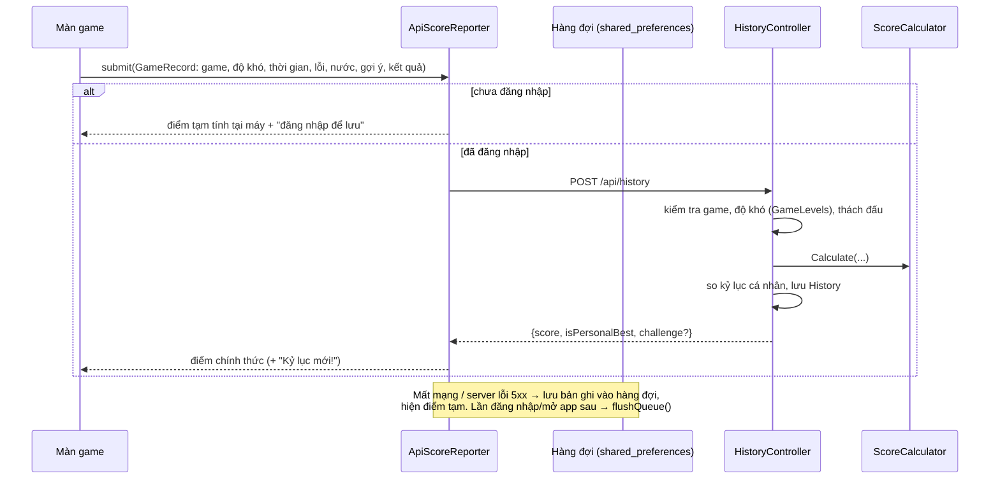

**Điểm tạm tại máy** (`core/models/score.dart`) dùng **đúng công thức của server**, chỉ để hiển thị khi chưa gửi được:
```
điểm = round(1000 × độ khó × clamp(par/thời gian, 0.25, 1.5) × 0.92^lỗi × 0.85^gợi ý)
```

**Xả hàng đợi** (`flushQueue`): gửi **lần lượt** từng bản ghi, nghỉ giữa hai lần; gặp lỗi mạng / 401 / 5xx thì **dừng** (lần sau thử tiếp); bản ghi bị 4xx (không hợp lệ) thì **bỏ** để không kẹt hàng đợi.

**Server** (`HistoryController.Submit`): chuẩn hoá → tìm game + level → kiểm tra thách đấu → tính điểm → kỷ lục cá nhân → lưu → nếu cả hai đã nộp thách đấu thì chọn người thắng.

---

## 5. Sudoku (`frontend_new/lib/sudoku/`)

### 5.1 Sinh đề (`logic/sudoku_generator.dart`)
1. Tạo bàn 9×9 rỗng; tạo bộ sinh ngẫu nhiên từ **seed** (nếu có) → cùng seed ra cùng đề.
2. Điền **3 khối 3×3 trên đường chéo** (khối 1, 5, 9) bằng hoán vị ngẫu nhiên 1–9 – ba khối này không chung hàng / cột nên không cần kiểm tra.
3. Điền các ô còn lại bằng **quay lui**: thử số 1–9 theo thứ tự xáo trộn; số hợp lệ (không trùng hàng, cột, khối) thì đi tiếp, bế tắc thì lùi lại.
4. Lưu **lời giải** đầy đủ.
5. Xoá ô theo thứ tự ngẫu nhiên tới khi còn đúng số ô gợi ý: Dễ 40 · Trung bình 32 · Khó 26 · Chuyên gia 22 · Ác mộng 17 (tối thiểu 17).

### 5.2 Chơi một ván (`logic/sudoku_controller.dart`)

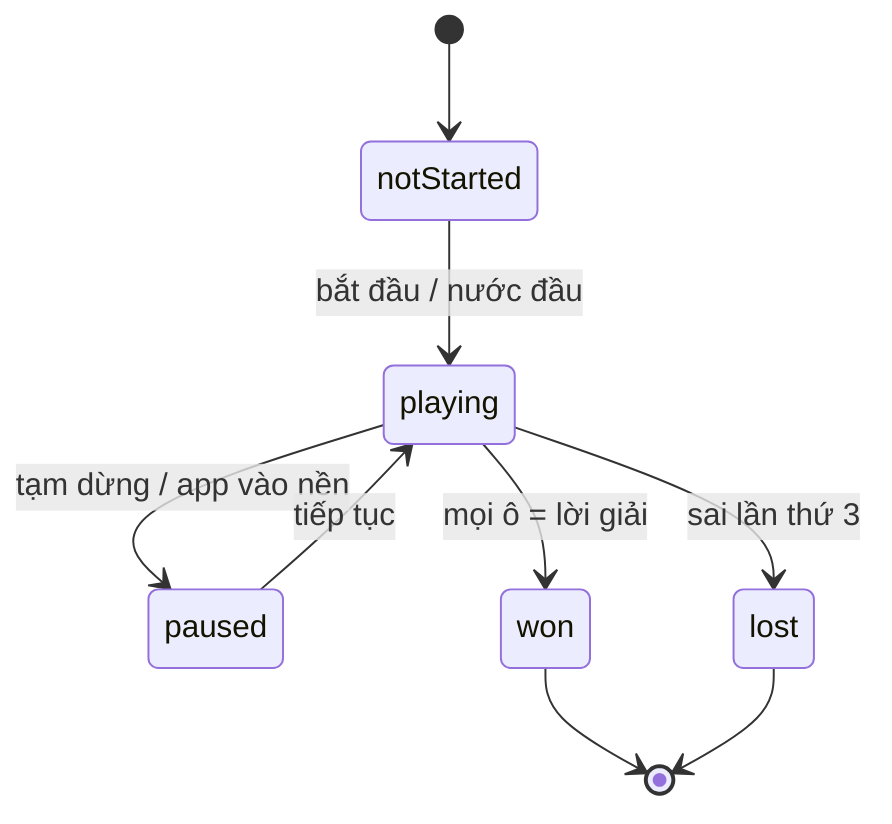

**Nhập số** (`inputNumber`):
1. Bỏ qua nếu chưa chọn ô, ô là số đề cho sẵn, hoặc ván không ở trạng thái `playing`.
2. **Chế độ ghi chú**: bật / tắt số đó trong ghi chú của ô, lưu vào lịch sử để hoàn tác.
3. **Chế độ điền**: ghi vào lịch sử (giá trị cũ, ghi chú cũ) → điền số:
   - **Đúng** lời giải → xoá lỗi, **tự xoá số này khỏi ghi chú** của các ô cùng hàng / cột / khối → kiểm tra thắng.
   - **Sai** → đánh dấu đỏ, `mistakes++`; đủ **3 lỗi** → thua.
4. Thắng ở chế độ Học → ghi thời gian màn đó.

**Gợi ý** (`hint`): điền đáp án đúng vào ô đang chọn, `hintsUsed++` → bị trừ 15% điểm mỗi lần.
**Hoàn tác** (`undo`): lấy nước cuối trong lịch sử, trả lại giá trị và ghi chú cũ.
**Kết thúc** (`sudoku_screen.dart`): cập nhật thống kê → nộp điểm (luồng mục 4, Chuyên gia / Ác mộng gửi qua `level` 4–5) → xoá ván lưu trên server.

### 5.3 Lưu và khôi phục ván (`saveGameToServer`, `restoreFromSavedGame`)
- Lưu khi **app vào nền** (đồng hồ tạm dừng): chỉ gửi **seed + chuỗi 81 ký tự trạng thái bàn + ghi chú (JSON) + thời gian + số lỗi**, không gửi cả đề.
- Khôi phục: **sinh lại đề từ seed** → điền lại các ô đã chơi → khôi phục ghi chú → ván ở trạng thái tạm dừng.
- Đổi tài khoản / đăng xuất → làm mới ván để không lưu nhầm ván của người trước.

### 5.4 Học Sudoku (`logic/sudoku_learning_manager.dart`)
- 30 màn, số ô gợi ý giảm dần: `clues = 50 − (màn − 1) × 32 / 29` → màn 1 có 50 ô, màn 30 có 18 ô.
- Thắng màn *n* → mở khoá màn *n + 1*, lưu thời gian tốt nhất; đồng bộ với server (`SudokuProgresses`) để đổi máy vẫn giữ tiến trình.

### 5.5 Toán Chéo (`screens/crossmath_screen.dart`)
- Bàn gồm ô số cho sẵn, ô phép toán và **ô trống**; bên dưới là **khay thẻ** (số / phép toán).
- Chọn ô trống → chọn thẻ → điền; thẻ đã dùng hết thì khoá.
- Mỗi lần điền kiểm tra: **mọi ô trống** đều khớp đáp án → hoàn thành, mở màn sau, nộp điểm (mức độ khó quy theo màn: 1–10 Dễ, 11–20 Vừa, 21–30 Khó).

### 5.6 Thống kê (`logic/sudoku_stats_manager.dart`)
Mỗi độ khó (1–5): số ván bắt đầu, số ván thắng, thắng không lỗi, thời gian tốt nhất, tổng thời gian thắng. Bắt đầu / thắng một ván → cập nhật tại máy + `POST /sudoku/stats`; mở màn thống kê → `syncWithServer()`.

### 5.7 Sudoku đồng đội: xem mục 10.5.

---

## 6. Caro – chơi trên máy (`frontend_new/lib/caro/`)

### 6.1 Một nước đi

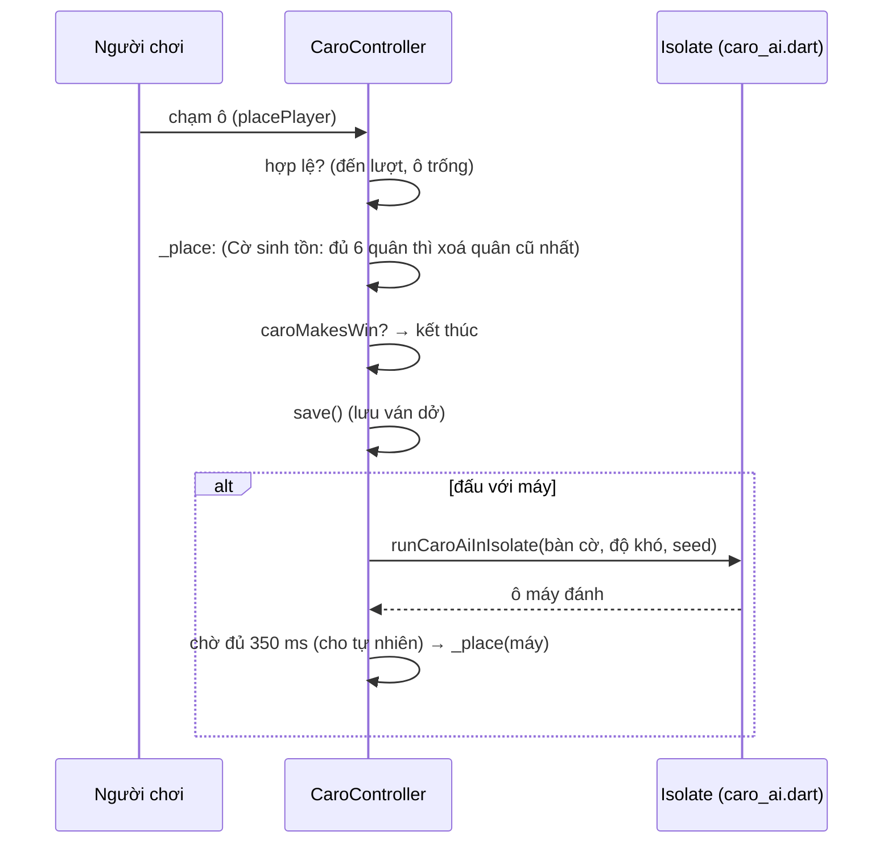
1. `placePlayer(idx)`: kiểm tra được đi, ô trống → bỏ gợi ý đang hiện → đặt quân.
2. `_place`:
   - **Cờ sinh tồn**: mỗi bên giữ danh sách quân đang sống; đủ **6** thì quân **cũ nhất** biến mất (hàng đợi FIFO).
   - `caroMakesWin`: đếm quân liên tiếp theo 4 hướng qua ô vừa đánh, ≥ 5 là thắng (luật tự do), lưu **đường thắng** để tô sáng.
   - Đầy bàn (không phải Cờ sinh tồn) → hoà.
3. Lượt máy (`_aiTurn`): tính trên **Isolate** (luồng riêng) để UI không giật; tính quá 300 ms mới hiện "Máy đang nghĩ…"; luôn chờ ít nhất 350 ms; Isolate lỗi thì tính lại mức Vừa ngay trên luồng chính; nước trả về không hợp lệ thì lấy ô trống đầu tiên. Có **số thế hệ** (`_gen`): ván mới / hoàn tác giữa chừng thì kết quả cũ bị bỏ.

### 6.2 AI chọn nước (`logic/caro_ai.dart`, hàm `chooseCaroMove`)
1. Chỉ xét **ô ứng viên** gần các quân đã có (đỡ tốn).
2. **Khó**: tra **khai cuộc chuẩn** ở vài nước đầu; tìm **VCF** của máy (chuỗi nước "bốn" ép thắng) – nhưng nếu người chơi đang có nước thắng ngay thì bỏ qua.
3. Chấm điểm từng ô: điểm **tấn công** (nếu máy đánh vào) + điểm **phòng thủ** (nếu người chơi đánh vào; mức Khó nhân 1,25) + thưởng gần tâm. Điểm thế cờ: năm 1.500.000 · bốn mở 120.000 · bốn chặn 20.000 · ba mở 8.000 · ba chặn 800 · hai mở 300 · hai chặn 50.
4. Thứ tự ưu tiên (mức Khó): thắng ngay → chặn đối thủ đủ 5 → tạo 4 mở / đòn đôi 4-4 → chặn 4 mở / 4-4 của đối thủ → chặn 4-3, 3-3 → chặn VCF của đối thủ → rồi mới tấn công.
5. Không có nước ép buộc:
   - **Dễ**: chọn ngẫu nhiên trong 5 ô điểm cao nhất (và 25% số lần bỏ qua đòn chiến thuật).
   - **Vừa**: ô điểm cao nhất (bằng điểm thì chọn ngẫu nhiên).
   - **Khó**: **minimax + alpha-beta**, đào sâu dần 2 → 5 tầng trong ngân sách **1,2 giây**, luôn giữ nước tốt nhất đã tìm được.

### 6.3 Gợi ý, hoàn tác, lưu ván
- **Gợi ý** (tối đa 3/ván): AI tính nước tốt nhất **cho người chơi**, tô sáng ô đó; dùng gợi ý bị trừ điểm.
- **Hoàn tác**: bỏ nước cuối (đấu máy thì bỏ cả nước máy), `_rebuildBoardFromHistory()` dựng lại bàn và danh sách quân Cờ sinh tồn từ lịch sử; số lần hoàn tác tính là **lỗi** khi chấm điểm.
- **Lưu**: sau mỗi nước lưu **tại máy** (theo tài khoản); khi **app vào nền hoặc rời màn chơi** thì lưu thêm lên server (`CaroSavedGames`). Mở lại: **ưu tiên bản trên server** (đổi máy vẫn chơi tiếp) → không có mạng thì lấy bản trong máy → kết thúc ván thì xoá bản lưu.
- **Thách đấu Caro**: người chơi luôn đi trước, máy dùng **seed xác định** từ mã thách đấu + thế cờ → hai người gặp cùng một "đối thủ máy"; không lưu ván dở.
- **Nộp điểm** chỉ khi đấu máy: thắng → điểm theo **số nước của mình** (par 20/30/45); hoà → 30%; thua → 0.

---

## 7. Rubik 3D (`frontend_new/lib/rubik/`)

### 7.1 Mô hình khối (`model/cube_model.dart`)
Khối = **54 sticker màu** (6 mặt × 9). `applyMove("R")`, `"U'"`, `"F2"`, `"M"`, `"x"`… xoay hình học: mọi sticker thuộc tầng bị quay quanh trục tương ứng. `isSolved` = mỗi mặt chỉ một màu.

### 7.2 Luyện giải (`practice/practice_controller.dart`)

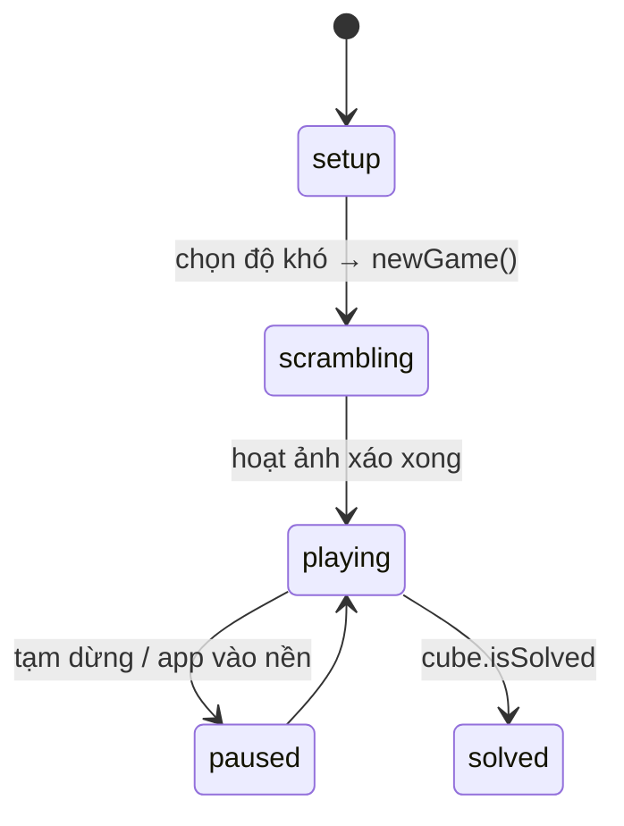
1. **Xáo** (`services/scramble.dart`): Dễ 5 nước · Vừa 11 · Khó 22; không có 2 nước liên tiếp cùng mặt (`R R'`), không 3 nước liên tiếp cùng trục (`R L R`) để không có nước thừa. Màn hình diễn hoạt từng nước xáo.
2. **Đồng hồ** chạy từ thao tác đầu tiên.
3. **Vuốt để xoay** (`render/turn_gesture.dart`): sticker nằm trên mặt có pháp tuyến *n* chỉ có thể bị kéo bởi tầng quay quanh 2 trục vuông góc với *n* → với mỗi trục, tính hướng sticker di chuyển trên màn hình khi quay một góc rất nhỏ → chọn trục khớp nhất với hướng ngón tay → sticker luôn "chạy theo tay" ở mọi góc nhìn. Vuốt vùng trống / 2 ngón = xoay góc nhìn.
4. `recordMove`: tăng số nước, ghi lịch sử (hoàn tác / làm lại), kiểm tra `isSolved` → giải xong thì dừng đồng hồ, xoá bản lưu, nộp điểm (Rubik gửi `mistakes = 0`, `hints = số gợi ý`).
5. **Gợi ý**: chạy bộ giải Kociemba từ **trạng thái hiện tại**, lấy **nước đầu tiên** của lời giải, tô sáng tầng cần xoay; mỗi gợi ý bị trừ 15% điểm.
6. **Lưu** sau mỗi nước; mở lại thì khôi phục ở trạng thái **tạm dừng**. "Xem lời giải" = bỏ cuộc.

### 7.3 Quét và giải khối thật

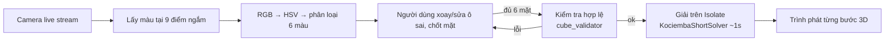
1. **Quét** (`scanner/camera_scanner_view.dart`): luồng ảnh camera trực tiếp; 9 vòng ngắm co dãn theo khoảng cách (thanh "Gần ↔ Xa"); có thể chụp ảnh tĩnh hoặc chọn ảnh từ thư viện; xoay 90° / 180° nếu cầm sai chiều; có bút màu để sửa tay; chốt từng mặt theo thứ tự có la bàn hướng dẫn.
2. **Nhận màu** (`rubik_color_detector.dart`): đổi RGB → **HSV**; độ bão hoà thấp + sáng → Trắng; còn lại phân theo **góc màu (hue)**: Đỏ, Cam, Vàng, Xanh lá, Xanh dương. Đây là **luật ngưỡng**, không phải học máy.
3. **Kiểm tra** (`services/cube_validator.dart`), báo lỗi từ dễ hiểu tới khó hiểu và **tô sáng ô cần sửa**:
   - mỗi màu đúng 9 ô;
   - 6 ô tâm khác màu nhau, đúng cặp đối diện;
   - từng viên cạnh / góc có tồn tại thật không;
   - cấu trúc Kociemba: độ lật cạnh, độ xoay góc, chẵn lẻ hoán vị.
   Kèm gợi ý cặp màu hay nhầm: Đỏ / Cam dưới đèn vàng, Trắng / Vàng khi ánh sáng ấm, hai màu xanh trong tối.
4. **Giải** (`services/offline_rubik_solver.dart`, `kociemba_short_solver.dart`): chạy trên **Isolate**, ngân sách **1 giây**. Thuật toán **Kociemba hai pha** (dùng bảng tra của thư viện `cuber`), cải tiến: tìm thấy lời giải dài *s* vẫn tìm tiếp với giới hạn *s − 1* cho tới hết giờ → thường 19–21 nước. Không ra kết quả thì giải lại bằng bản gốc (tối đa 4 giây). Chạy **hoàn toàn offline**.
5. **Trình phát** (`screens/solve_player_screen.dart`): mỗi bước có hoạt ảnh 3D + mô tả tiếng Việt (ví dụ "xoay mặt phải theo chiều kim đồng hồ"); lùi bước = áp nước **nghịch đảo**.

---

## 8. Xếp hình (`frontend_new/lib/XepHinh/`)

### 8.1 Sliding – xếp số trượt (`sliding_puzzle/sliding_puzzle_logic.dart`)
1. **Xáo**: hoán vị ngẫu nhiên các ô (có seed khi đua online), **lặp lại cho tới khi đề giải được và chưa giải sẵn**:
   - Đếm **số nghịch thế** (số cặp ô đứng sai thứ tự).
   - Lưới **lẻ** (3×3, 5×5): giải được ⇔ số nghịch thế **chẵn**.
   - Lưới **chẵn** (4×4): xét thêm **hàng của ô trống** tính từ dưới lên.
2. **Di chuyển** (`moveTile`): chỉ ô **kề** ô trống (trên / dưới / trái / phải) mới trượt được → đổi chỗ, `moves++`.
3. **Tiến độ** = % ô số đang đúng chỗ (dùng cho thanh tiến độ khi **đua online**).
4. Mọi ô đúng chỗ → hoàn thành → nộp điểm (par 60/240/600 giây theo lưới 3×3/4×4/5×5).

### 8.2 Jigsaw – ghép tranh (`jigsaw_puzzle/jigsaw_puzzle_logic.dart`)
1. Cắt ảnh (có sẵn hoặc **chọn từ thư viện máy**) thành lưới N×N mảnh; xáo vị trí.
2. Chạm mảnh thứ nhất (chọn) → chạm mảnh thứ hai → **đổi chỗ** hai mảnh (chạm lại mảnh đang chọn = bỏ chọn), `moves++`.
3. Mọi mảnh về đúng hàng / cột → hoàn thành → nộp điểm.

### 8.3 PhaseShift – khối nguyên tố (`phaseshift/`)

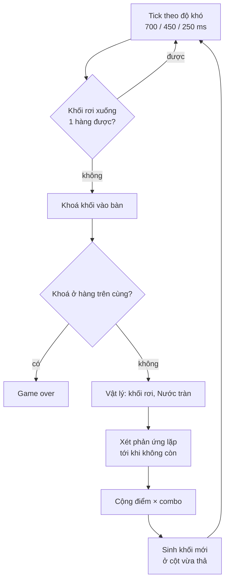
- **Điều khiển**: trái / phải, rơi nhanh (soft drop), thả ngay (hard drop), tạm dừng, xem luật.
- **Phản ứng** (`engine/reaction_engine.dart`), xét lặp lại tới khi bàn không đổi nữa; mỗi phản ứng nối tiếp **tăng combo**, điểm nhân combo:

| Kết hợp | Kết quả | Điểm cơ bản |
|---|---|---|
| Điện cạnh bất kỳ khối | Nổ, xoá khối xung quanh | 100 / khối |
| Nước cạnh Lửa | Dập tắt Lửa | 150 |
| Băng cạnh Nước | Nước đóng băng thành Băng | 150 / khối |
| Lửa cạnh Băng | Băng tan thành Nước | 150 |
| Axit cạnh Đá | Đá bị hoà tan | 200 |
| Lạnh cạnh Nước | Nước đóng băng | 150 / khối |

- **Vật lý** (`engine/physics_engine.dart`): khối lơ lửng rơi xuống ô trống; Nước tràn sang ô trống bên cạnh nếu bên dưới trống.
- **Kết thúc**: khối bị khoá ở hàng trên cùng (đầy bảng) hoặc hết giờ nếu bật tuỳ chọn **"Giới hạn thời gian (3 phút)"** ở màn chọn chế độ. Lưu điểm cao nhất tại máy.

---

## 9. Bảng xếp hạng

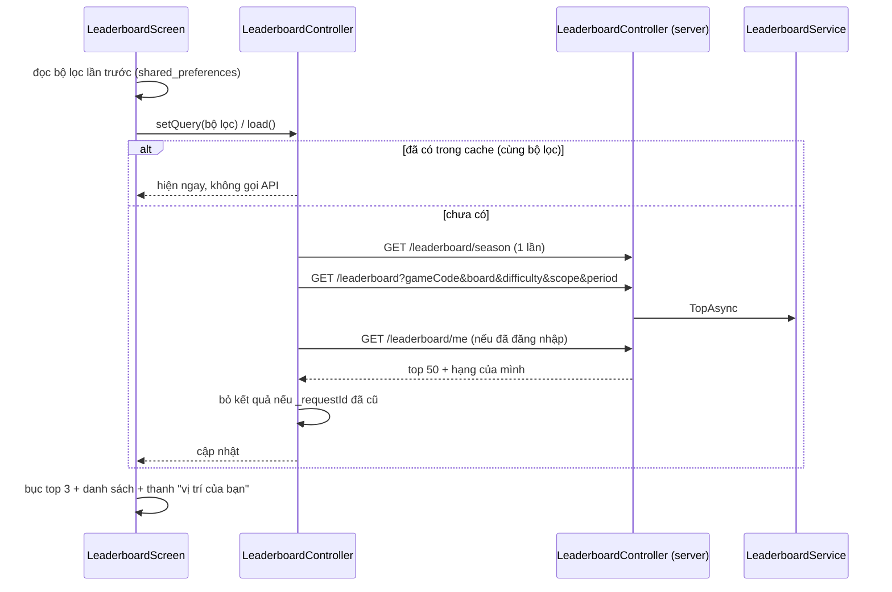
**Phía server** (`LeaderboardService.cs`):
- **Kỷ lục**: lấy History chơi đơn (COMPLETED/WIN, điểm > 0, đúng game, đúng độ khó, trong tuần nếu `season`, chỉ bạn bè nếu `friends`) → `BuildRecordBoard` (mỗi người 1 dòng tốt nhất) → `RanksOf` (hạng 1-2-2-4) → lấy top.
- **Đối kháng**: PlayerRatings của game (có ≥ 1 trận; "tuần này" = có trận RANKED trong tuần) → `OrderRatings` → hạng → top, kèm bậc, số trận, số thắng.
- `/me` tính **trên cùng danh sách** → hạng luôn khớp.

**Phía app** (`leaderboard_screen.dart`):
- **Thanh "vị trí của bạn"**: hạng 1 → "Bạn đang dẫn đầu"; bảng Đối kháng → "Còn N điểm để lên <bậc kế>"; bảng Kỷ lục → tìm người **ngay trên mình** trong danh sách → "Thêm (điểm họ − điểm mình + 1) điểm để vượt <tên>". Bấm thanh → cuộn tới dòng của mình.
- Đổi bộ lọc → lưu lại; độ khó Sudoku 1–5, game khác 1–3 (đổi sang game 3 mức thì kẹp về Khó).
- Khách bấm vào người chơi → mời đăng nhập; đã đăng nhập → mở thẻ hồ sơ người đó (kết bạn, mời đấu).

---

## 10. Đối kháng online

Trạng thái phía app (`MatchSession.phase`): `idle → queued / inviting → active → ended → idle`.

### 10.1 Tìm trận xếp hạng

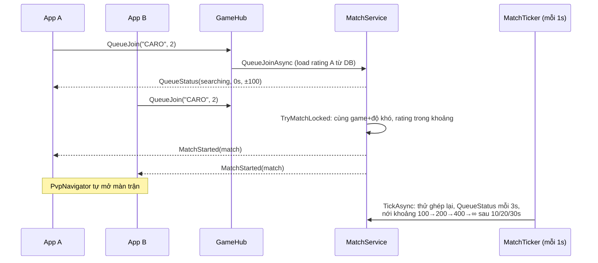
- Đang trong trận khác → lỗi "Bạn đang trong một trận đấu". Vào hàng đợi thì các lời mời của mình bị huỷ.
- Ghép: duyệt người **chờ lâu nhất trước**, chọn đối thủ **chênh rating ít nhất** trong khoảng cho phép (lấy khoảng rộng hơn của hai người).
- `QueueLeave` để huỷ tìm; mất kết nối thì tự rời hàng đợi.

### 10.2 Mời bạn giao hữu
1. `Invite(friendId, game, độ khó)` → server kiểm tra: là **bạn bè**, bạn đang **online**, không ai đang trong trận → tạo lời mời (hết hạn **30 giây**) → bạn nhận `InviteReceived` (hộp mời hiện ở mọi màn hình, có đếm ngược).
2. `RespondInvite(accept)`:
   - Đồng ý → `StartLocked(mode = FRIENDLY)` → cả hai nhận `MatchStarted`, người mời nhận `InviteResult(accepted, matchId)`.
   - Từ chối / hết hạn → người mời nhận `InviteResult(declined / expired)`.

### 10.3 Bắt đầu trận (`StartLocked`)
- Tạo `matchId` (GUID), **seed** ngẫu nhiên, 2 slot người chơi.
- **TURN** (Caro): chọn ngẫu nhiên người đi trước, hạn nước 30 giây.
- **RACE** (đua): giới hạn 15 phút.
- **COOP** (Sudoku đồng đội, chỉ giao hữu): giới hạn 30 phút, người mời đi trước.
- Báo `MatchStarted` + trạng thái **in_match** cho bạn bè.

### 10.4 Caro online – một nước đi

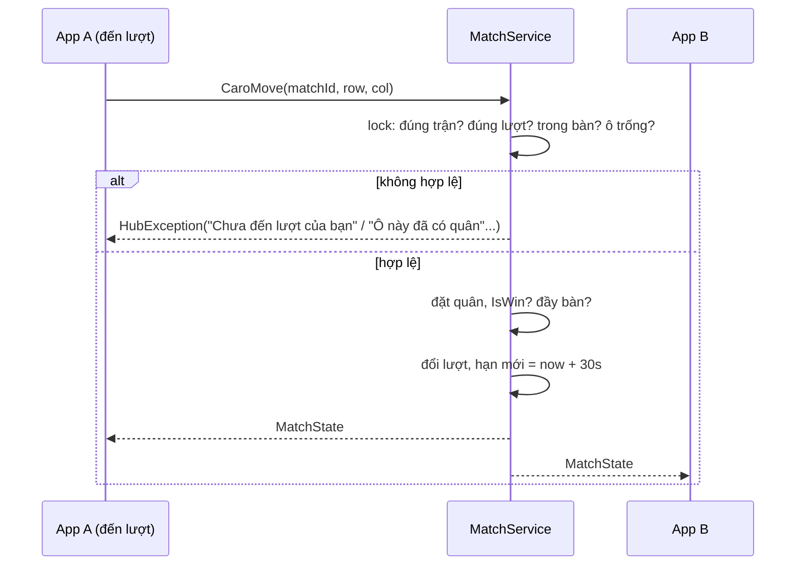
- App **không tự đặt quân** – chờ `MatchState` từ server rồi mới vẽ (server là nguồn chuẩn). Có chế độ "chạm 2 lần" (xem trước ô rồi xác nhận) hoặc "chạm 1 lần".
- Hết 30 giây chưa đi → `TickAsync` xử thua lý do **TIMEOUT**.
- **Xin hoà**: tối đa 3 lần / trận; đối thủ đồng ý → hoà; đối thủ **đi tiếp** = từ chối.
- **Đầu hàng**: xác nhận → `Resign` → đối thủ thắng (RESIGN). Bấm Back khi đang đấu cũng hỏi đầu hàng; cả hai đều thấy bảng kết quả, chỉ có nút **Về sảnh**.

### 10.5 Sudoku đồng đội
1. Hai máy sinh **cùng đề** từ seed của trận.
2. Đến lượt mình: chọn ô → điền số → app tự kiểm tra đúng / sai so với lời giải → `SudokuMove(row, col, val, isMistake)`.
3. Server: đúng lượt? → ghi nước, cộng lỗi chung nếu sai → **đổi lượt** → phát `SudokuMoveApplied` cho cả hai (kèm lượt kế, số lỗi). Đủ **3 lỗi chung** → thua (MISTAKES_LIMIT).
4. Chưa tới lượt vẫn được **ghi chú**; vị trí ô đang chọn gửi qua `SudokuCursor` để đồng đội thấy.
5. Điền xong bàn → `SudokuFinish` → cả hai **cùng thắng** (COOP_WIN). Hết 30 phút → TIME_LIMIT.
6. Tái đấu → server tạo trận mới với **seed mới** → đề hoàn toàn mới.

### 10.6 Đua Xếp số
1. Cùng seed → cùng đề; đếm ngược 3-2-1 rồi mới cho chạm.
2. Mỗi lần tiến độ thay đổi → `RaceProgress(percent)` (server bỏ qua nếu gửi quá 4 lần/giây) → đối thủ nhận `OpponentProgress` (thanh tiến độ của đối thủ).
3. Xong → `RaceFinish(timeMs, mistakes)`; server kiểm tra: tiến độ ≥ 90%, thời gian ≥ mức tối thiểu hợp lý của game, không dài hơn thời gian thật của trận quá 3 giây → người về trước thắng.
4. Hết 15 phút → ai tiến độ cao hơn thắng (bằng nhau → hoà).

### 10.7 Kết thúc trận (dùng chung mọi loại)

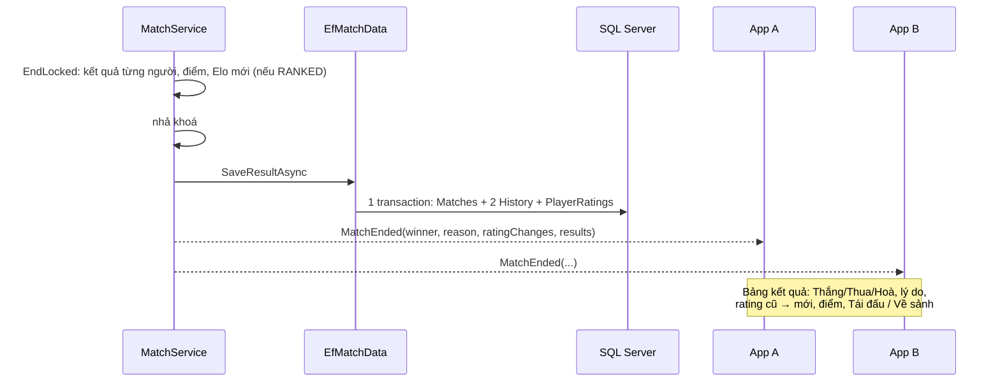
**Lý do kết thúc**: `WIN`, `DRAW`, `RESIGN`, `TIMEOUT`, `ABANDON`, `TIME_LIMIT`, `COOP_WIN`, `MISTAKES_LIMIT`, `SERVER_RESTART`.

**Tái đấu**: trong **30 giây** sau trận, một người gửi `Rematch` → đối thủ nhận `RematchRequested`; cả hai cùng gửi → trận mới cùng game, cùng độ khó, seed mới, dùng **rating vừa cập nhật** (Caro vẫn chọn ngẫu nhiên người đi trước). Đối thủ đã rời / đang trong trận khác → báo lỗi.

### 10.8 Rớt mạng giữa trận

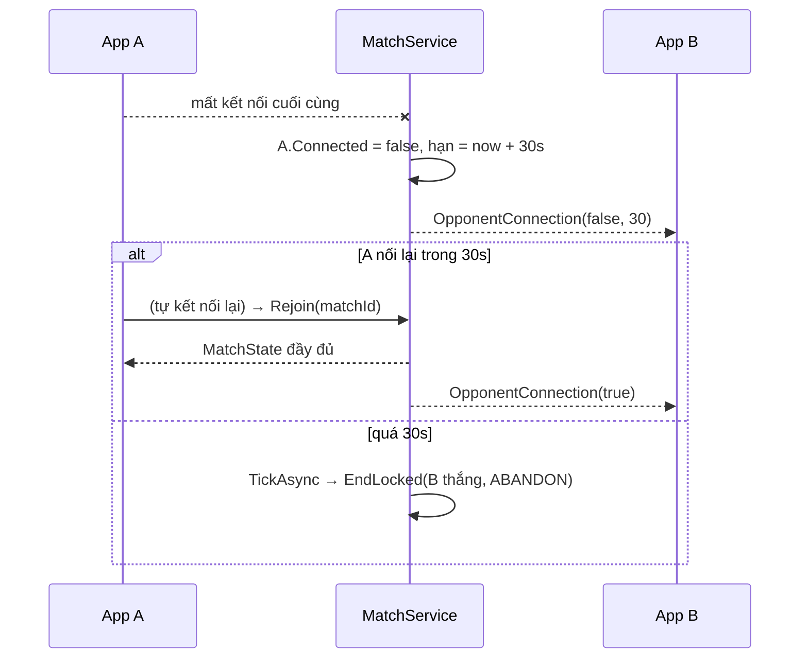

### 10.9 Server khởi động lại
`ShutdownAsync`: mọi trận đang chơi kết thúc lý do **SERVER_RESTART** – không ghi DB, không đổi rating; app hiện "Trận bị huỷ".

---

## 11. Xã hội

### 11.1 Kết bạn
1. Tìm người (`GET /users/search?q=`, ≥ 2 ký tự, tối đa 20, bỏ qua chính mình).
2. `POST /friends/requests {userId}`:
   - Bên kia **đã mời mình** → **tự thành bạn** (ACCEPTED), cả hai nhận `FriendAccepted`.
   - Ngược lại → tạo lời mời PENDING, người kia nhận `FriendRequest` (realtime).
   - Đã là bạn / đã mời → 409; tự mời mình → 400; không tồn tại → 404.
3. Người nhận `accept` / `decline` (chỉ người nhận được làm; không còn PENDING → 409).
4. Huỷ kết bạn / thu hồi lời mời: `DELETE /friends/{userId}`.
5. Mỗi **cặp** chỉ có 1 dòng trong `Friendships` (khoá duy nhất theo id nhỏ – id lớn).

### 11.2 Nhắn tin

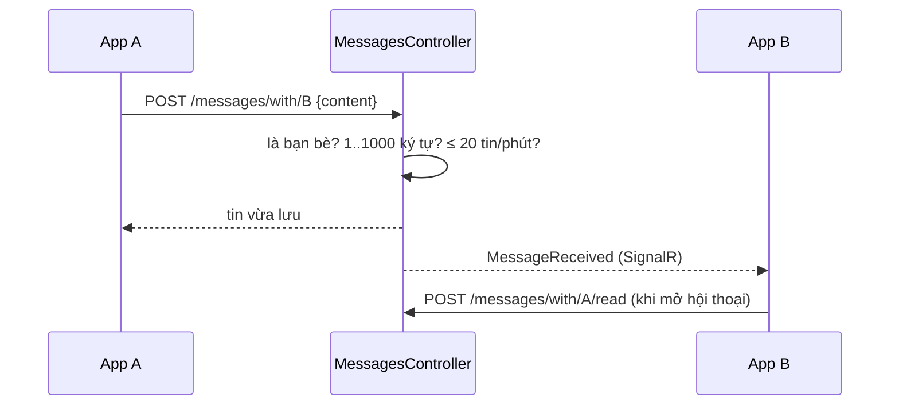
- Danh sách hội thoại: đối tác, tin cuối, số tin chưa đọc.
- Tải tin theo `messageId` tăng dần: `afterId` (tin mới hơn), `beforeId` (cuộn lên xem tin cũ), mặc định 30, tối đa 100.
- App **gộp** tin mới từ realtime với tin tải từ API, bỏ trùng theo `messageId` (`friends/logic/message_merge.dart`).
- `GET /social/summary`: số tin chưa đọc, thách đấu đến, thách đấu đang chơi → hiện **huy hiệu** trên tab.

### 11.3 Thách đấu bất đồng bộ

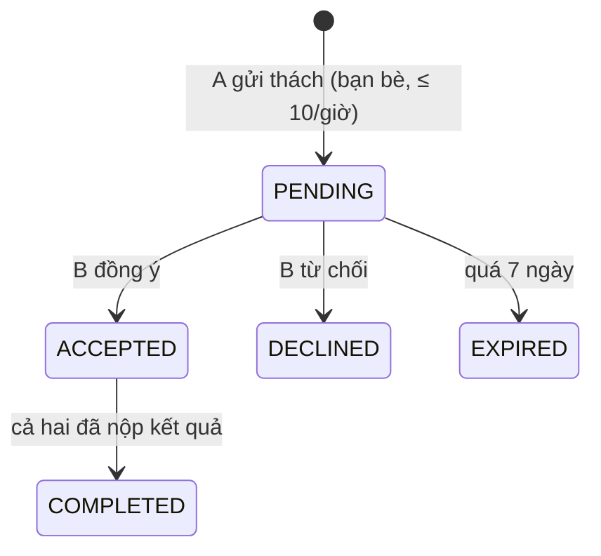
1. Hai người chơi **cùng đề** (seed = mã thách đấu), mỗi người một lúc.
2. Mỗi người nộp **1 lần** qua `POST /history` kèm `challengeId`.
3. Người nộp sau kích hoạt `DecideWinner`: điểm cao hơn thắng → bằng điểm thì thời gian ngắn hơn → vẫn bằng (hoặc cả hai 0 điểm) thì hoà.
4. Danh sách thách đấu lấy một lần (`box=all`); lời PENDING quá 7 ngày tự thành EXPIRED khi mở danh sách.

---

## 12. Hồ sơ (`frontend_new/lib/profile/`)

1. Mở tab lần đầu → `ProfileController.load()` gọi **tuần tự**: `/ratings/me` (rating 4 game) → `/users/{me}/profile` (bổ sung kỷ lục) → `/matches?page=1`.
2. Thẻ người dùng: tên, username, email, **bậc rank cao nhất** trong các game.
3. **Trận gần đây**: chỉ 3 trận; nhiều hơn thì có nút **"Xem tất cả (N)"** → màn Lịch sử trận đấu: cuộn gần cuối (còn < 400 px) tự tải trang tiếp; có nút "Tải thêm" dự phòng; kéo xuống để làm mới. Dùng chung controller nên không tải lại trang đầu.
4. **Sửa tên hiển thị**: `PUT /users/me {fullName}`.
5. **Đổi mật khẩu**: hộp thoại 3 ô (hiện tại, mới, nhập lại) → kiểm tra tại máy (6–72 ký tự, khác mật khẩu cũ, nhập lại khớp) → `PUT /users/me/password` → sai mật khẩu hiện tại: **400**, báo ngay trong hộp thoại (không đăng xuất) → thành công: đóng hộp, thông báo "Đã đổi mật khẩu".
6. Giao diện: Hệ thống / Sáng / Tối; Đăng xuất (có xác nhận).

---

## 13. Đường đi của một request trên server

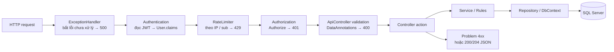
**Hub SignalR** đi đường riêng: kết nối `/hubs/game?access_token=…` → xác thực JWT → `[Authorize]` → mỗi lệnh từ app gọi method tương ứng trong `GameHub` → `MatchService` (trong `lock`) → lỗi nghiệp vụ trả `HubException`; thông báo đẩy xuống qua `IRealtimeNotifier` tới **mọi kết nối** của người nhận.

**Khi server khởi động**: nạp `.env` → kiểm tra `Jwt:Key` ≥ 32 ký tự → đăng ký DI → dựng pipeline → **tự chạy migration** (lỗi chỉ ghi cảnh báo) → nhận request.

---

## 14. Máy trạng thái và bảng mã lỗi

### 14.1 Tóm tắt các máy trạng thái
| Đối tượng | Trạng thái |
|---|---|
| Phiên đăng nhập (app) | khách ↔ đã đăng nhập (± ngoại tuyến) |
| Kết nối realtime | disconnected → connecting → connected ⇄ reconnecting |
| Đối kháng (app) | idle → queued / inviting → active → ended → idle |
| Ván Sudoku | notStarted → playing ⇄ paused → won / lost |
| Ván Caro (máy) | setup → playing → finished |
| Luyện Rubik | setup → scrambling → playing ⇄ paused → solved |
| Thách đấu | PENDING → ACCEPTED → COMPLETED (hoặc DECLINED / EXPIRED) |
| Lời mời kết bạn | PENDING → ACCEPTED (hoặc bị từ chối / thu hồi) |
| Trận online (server) | đang chơi → kết thúc (lý do ở mục 10.7) → giữ 30s để tái đấu |

### 14.2 Mã HTTP dùng trong dự án
| Mã | Khi nào | App xử lý |
|---|---|---|
| 200 / 204 | Thành công | Cập nhật giao diện |
| 400 | Dữ liệu sai, sai mật khẩu hiện tại, độ khó không có cho game | Hiện thông điệp của server |
| 401 | Chưa đăng nhập / token hết hạn / sai mật khẩu khi đăng nhập | Request có token → tự đăng xuất |
| 403 | Không phải bạn bè (nhắn tin, thách đấu) | Hiện thông điệp |
| 404 | Không tìm thấy (người chơi, lời mời, thách đấu) | Hiện thông điệp |
| 409 | Trùng (đã là bạn, đã nộp kết quả thách đấu, username đã có) | Hiện thông điệp |
| 429 | Thao tác quá nhanh (rate limit) | "Bạn thao tác quá nhanh…" |
| 5xx / mất mạng | Lỗi server / không kết nối được | Nộp điểm: xếp hàng đợi gửi sau; nơi khác: báo lỗi + nút thử lại |
