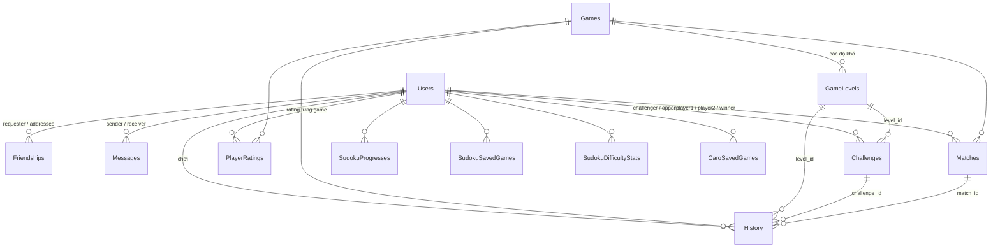

# Phần của Bình: Toàn bộ Backend + VPS + Cơ sở dữ liệu

> Tài liệu học và chuẩn bị bảo vệ. Đọc theo thứ tự: mỗi mục có **ý tưởng → code thật (file:dòng) → ví dụ → câu hỏi hay gặp**.
> Tổng quan cả dự án xem `TONG_QUAN_DU_AN.md`; từng luồng chạy xem `LUONG_XU_LY_CHI_TIET.md`.

---

## 0. Bình làm những phần nào?

**Phần chính của Bình gồm ba khối:**
1. **Toàn bộ thư mục `backend/`** – mọi Controller, Service, Repository, Model, Migration và test của server, **kể cả API lưu dữ liệu của Sudoku và Caro** mà app của Đoàn và Phúc gọi tới.
2. **Cơ sở dữ liệu** – thiết kế 13 bảng, quan hệ, chỉ mục, ràng buộc, migration, vận hành DB.
3. **VPS** – đưa server lên máy chủ Linux, chạy 24/7, cập nhật, sao lưu.

Các bạn khác làm **phía app** của trò chơi mình (Đoàn: Sudoku; Phúc: Caro; Tâm: Xếp hình) và gọi API do Bình viết.

### 0.1 Backend – toàn bộ file

| Mảng | Nội dung | File (trong `backend/GameHub.Api/`) |
|---|---|---|
| **Khởi động & cấu hình** | DI, JWT, rate limit, Swagger, CORS, pipeline, tự migrate, nạp `.env` | `Program.cs`, `Services/DotEnv.cs` |
| **Tài khoản** | Đăng ký, đăng nhập (BCrypt + JWT), hồ sơ, tìm người, **đổi mật khẩu** | `Controllers/AuthController.cs`, `Controllers/UsersController.cs`, `Services/TokenService.cs` |
| **Danh mục game** | Danh sách game + các mức độ khó | `Controllers/GamesController.cs`, `Services/GameQueries.cs` |
| **Tính điểm & lịch sử** | Công thức điểm, gợi ý, 5 mức Sudoku, nộp kết quả, kỷ lục cá nhân | `Services/ScoreCalculator.cs`, `Controllers/HistoryController.cs` |
| **Xếp hạng** | Bảng Kỷ lục / Đối kháng, mùa giải, hạng 1-2-2-4, "hạng của bạn" | `Controllers/LeaderboardController.cs`, `Services/LeaderboardService.cs`, `Services/LeaderboardRules.cs` |
| **Elo, bậc, mùa** | Công thức Elo, K, 5 bậc, cửa sổ tuần | `Services/Ratings.cs`, `Controllers/MatchesController.cs` (`/ratings/me`, `/matches`) |
| **Realtime / Đối kháng** | Hub SignalR, ghép trận, mời bạn, Caro online, đua, Sudoku đồng đội, kết nối lại, ghi kết quả | `Services/GameHub.cs`, `Services/MatchService.cs`, `Services/MatchData.cs`, `Services/Rules.cs`, `Services/Infra.cs` |
| **Online / offline** | Theo dõi kết nối nhiều thiết bị, phát trạng thái tới bạn bè | `Services/PresenceService.cs` |
| **Xã hội** | Bạn bè, nhắn tin, thách đấu, huy hiệu | `Controllers/FriendsController.cs`, `MessagesController.cs`, `ChallengesController.cs`, `SocialController.cs`, `Services/ChallengeRules.cs`, `ChallengeService.cs`, `FriendQueries.cs`, `StatsQueries.cs` |
| **API Sudoku** | Tiến trình 30 màn Học, ván đang chơi, thống kê 5 độ khó | `Controllers/SudokuController.cs`, `Services/sudoku/SudokuService.cs`, `Repositories/sudoku/`, `model/sudoku/` |
| **API Caro** | Lưu / tải / xoá ván Caro đang chơi (đổi máy vẫn chơi tiếp) | `Controllers/CaroController.cs`, `Services/CaroService.cs`, `Repositories/CaroRepository.cs` |
| **Truy cập dữ liệu** | Repository cho từng nhóm bảng | `Repositories/*.cs` |
| **Bảo mật & lỗi** | Rate limiting, ProblemDetails, xử lý lỗi chung, lấy user id từ token | `Services/RateLimitPolicies.cs`, `Services/Extensions.cs`, `Controllers/ApiControllerBase.cs` |
| **Mô hình dữ liệu** | Entity, DTO, DbContext (Fluent API) | `model/Entities.cs`, `model/Dtos.cs`, `model/GameHubDbContext.cs` |
| **Migration** | 5 migration, tự áp khi khởi động | `Migrations/` |
| **Kiểm thử** | 126 test xUnit | `backend/GameHub.Tests/` |

### 0.2 Cơ sở dữ liệu và VPS
| Mảng | Nội dung | Xem mục |
|---|---|---|
| **Cơ sở dữ liệu** | 13 bảng, quan hệ, chỉ mục, CHECK, migration, host SQL Server | 12 |
| **VPS** | Linux + systemd, cấu hình bí mật, giới hạn RAM, cập nhật, sao lưu, khôi phục | 14 |

### 0.3 Phía app Bình cũng làm (phần lõi nối với backend)
| Mảng | File |
|---|---|
| ApiClient, đăng nhập / khôi phục phiên, RealtimeService, MatchSession, hàng đợi điểm offline | `frontend_new/lib/core/`, `auth/`, `pvp/` |
| Màn Đối kháng, Xếp hạng (bục top 3…), Hồ sơ (lịch sử trận, đổi mật khẩu), logo app | `pvp/`, `leaderboard/`, `profile/` |
| Rubik (giới thiệu lại khi thuyết trình) | `frontend_new/lib/rubik/` |

---

## 1. Chạy backend ở máy

```bash
cd backend/GameHub.Api
dotnet run                      # mở http://localhost:5214/swagger
cd .. && dotnet test            # 126 test
```
Cấu hình bí mật (chuỗi kết nối, `Jwt:Key` ≥ 32 ký tự) nằm trong `appsettings.Development.json` hoặc `.env` – **không commit**. `Program.cs:14` nạp `.env` thành biến môi trường.

---

## 2. Kiến trúc backend

### 2.1 Ba tầng

```
HTTP request
   ↓
Controller  ── kiểm tra đầu vào, lấy userId từ token, trả mã HTTP
   ↓
Service     ── luật nghiệp vụ: tính điểm, Elo, xếp hạng, trận đấu
   ↓
Repository  ── truy vấn CSDL qua EF Core (DbContext)
   ↓
SQL Server
```
- **Controller** mỏng; **Service** chứa luật; **luật thuần** (không đụng DB) tách riêng thành lớp `static` để test dễ: `ScoreCalculator`, `LeaderboardRules`, `Elo`, `ChallengeRules`, `CaroRules`, `RaceRules`, `DifficultyRules`.
- `ApiControllerBase` cung cấp `CurrentUserId` = claim `sub` trong JWT (`Extensions.cs:10`).

### 2.2 Dependency Injection – vì sao chỗ Scoped, chỗ Singleton? (`Program.cs:27-56`)

| Đăng ký | Vòng đời | Lý do |
|---|---|---|
| Repository, `TokenService`, `LeaderboardService`… | **Scoped** (mỗi request 1 bản) | Dùng `DbContext` – DbContext không an toàn khi dùng chung nhiều luồng |
| `MatchService`, `PresenceService`, `ConnectionTracker` | **Singleton** (cả server 1 bản) | Giữ **trạng thái trận / kết nối trong bộ nhớ**, phải dùng chung cho mọi người chơi |
| `MatchTicker` | **HostedService** | Chạy nền, mỗi giây "tick" đồng hồ trận |
| `IClock` | Singleton | Test thay bằng đồng hồ giả để điều khiển thời gian |

> Singleton không được giữ DbContext → `EfMatchData` mở **scope mới** mỗi lần cần DB (`MatchData.cs:31`, `IServiceScopeFactory`).

### 2.3 Thứ tự pipeline (`Program.cs:135-175`)
`ExceptionHandler` → `StatusCodePages` → (CORS khi dev) → Swagger → **Authentication → RateLimiter → Authorization** → Controllers + Hub `/hubs/game` → **tự Migrate DB** → `app.Run()`.

Xác thực đặt **trước** RateLimiter để giới hạn theo người dùng đọc được claim `sub`.

---

## 3. Tài khoản và bảo mật

### 3.1 Đăng ký / đăng nhập (`AuthController.cs`)
- **Đăng ký**: kiểm tra trùng username / email (409), băm mật khẩu `BCrypt.HashPassword`, lưu, trả `{token, user}`.
- **Đăng nhập**: tìm theo username **hoặc** email, `BCrypt.Verify`; sai → **401** "Sai tên đăng nhập hoặc mật khẩu" (không nói rõ sai cái nào, chống dò tài khoản).
- Validation bằng **DataAnnotations** trên DTO (`Dtos.cs`): username 3–50 ký tự `[a-zA-Z0-9_]`, mật khẩu 6–72 ký tự (BCrypt chỉ dùng 72 byte đầu).

> **Vì sao BCrypt?** Băm chậm có "salt" ngẫu nhiên → cùng mật khẩu ra chuỗi khác nhau, dò bằng bảng tra (rainbow table) vô dụng, thử từng mật khẩu rất tốn.

### 3.2 JWT (`TokenService.cs:24-39`)
```csharp
Subject = new ClaimsIdentity([
    new Claim(JwtRegisteredClaimNames.Sub, user.UserId.ToString()),   // "sub" = id người dùng
    new Claim(JwtRegisteredClaimNames.UniqueName, user.Username),
]),
Expires = DateTime.UtcNow.AddDays(_o.LifetimeDays),                  // 7 ngày
SigningCredentials = ... HmacSha256                                   // ký bằng Jwt:Key
```
- Server kiểm: issuer, audience, chữ ký, hạn (`Program.cs:72-82`), lệch giờ cho phép 1 phút.
- `MapInboundClaims = false` → claim giữ đúng tên `sub` (không bị đổi thành URI dài).
- **SignalR** không gửi được header qua WebSocket → app gửi token qua query `?access_token=…`; `OnMessageReceived` (`Program.cs:63-70`) chỉ nhận cách này với đường dẫn `/hubs`.

### 3.3 Đổi mật khẩu (`UsersController.cs`, `PUT /api/users/me/password`)
1. Lấy user theo `CurrentUserId`.
2. `BCrypt.Verify(currentPassword)` sai → **400** "Mật khẩu hiện tại không đúng".
3. Mật khẩu mới trùng mật khẩu cũ → 400.
4. Băm mật khẩu mới, lưu, trả **204**.

> **Vì sao 400 mà không 401?** App coi 401 là "phiên hết hạn" và **tự đăng xuất**. Gõ sai mật khẩu cũ không phải lỗi phiên → dùng 400 để báo ngay trong hộp thoại.
> Rate limit **5 lần / 15 phút / người** – chống ai đó cầm token bị lộ dò mật khẩu cũ.
> Hạn chế còn lại: token cũ vẫn dùng được tới khi hết hạn (7 ngày). Muốn đăng xuất mọi thiết bị cần thêm cơ chế thu hồi token (ví dụ lưu "phiên bản token" trong bảng Users).

### 3.4 Rate limiting (`Program.cs:91-109`, `RateLimitPolicies.cs`)

| Chính sách | Giới hạn | Phân vùng theo |
|---|---|---|
| `auth` (đăng ký / đăng nhập) | 10 / phút | IP |
| `send-message` | 20 / phút | user (`sub`) |
| `create-challenge` | 10 / giờ | user |
| `change-password` | 5 / 15 phút | user |

Vượt → **429** kèm thông điệp tiếng Việt. Kiểu **Fixed Window**: đếm số yêu cầu trong mỗi khung thời gian cố định.

### 3.5 Lỗi trả về thống nhất
- Sai dữ liệu đầu vào → `[ApiController]` tự trả **400 ProblemDetails** (RFC 7807) liệt kê lỗi từng trường.
- Lỗi nghiệp vụ → `Problem(statusCode: 4xx, title: "…")`.
- Lỗi không lường trước → `GlobalExceptionHandler` (`Extensions.cs:14`) ghi log, trả 500; **chỉ khi dev** mới lộ chi tiết lỗi.
- Trong hub SignalR: lỗi nghiệp vụ ném `HubException("…")` → app hiện thông báo.

---

## 4. Tính điểm (`ScoreCalculator.cs`)

### 4.1 Công thức
```
base            = 1000 × độ khó          (Sudoku có tới 5 mức → tối đa 5000)
hệ số thời gian = clamp(par / thời gian thực, 0.25, 1.5)
hệ số lỗi       = 0.92 ^ số lỗi
hệ số gợi ý     = 0.85 ^ số gợi ý
điểm            = round(base × thời gian × lỗi × gợi ý)
LOSE / ABANDONED = 0 ;  Caro DRAW = 30%
```
- **Par** = thời gian chuẩn: Sudoku 360/720/1500/2000/3000 s, Xếp hình 60/240/600 s, Rubik 90/240/600 s.
- **Caro** không dùng thời gian mà dùng **số nước của mình** (par 20/30/45): thắng càng ít nước càng giỏi.
- `clamp`: nhanh tới đâu cũng tối đa ×1,5; chậm tới đâu cũng tối thiểu ×0,25 (không âm, không vô hạn).

### 4.2 Ví dụ
Sudoku **Vừa** (base 2000, par 720 s), giải trong **600 s**, sai **2**, dùng **1 gợi ý**:
```
thời gian = 720 / 600 = 1.2
lỗi       = 0.92² = 0.8464
gợi ý     = 0.85
điểm      = 2000 × 1.2 × 0.8464 × 0.85 = 1726.66 → 1727
```

### 4.3 Vì sao server tính?
App chỉ gửi **dữ liệu thô** (thời gian, số lỗi, số nước, số gợi ý, kết quả). Nếu app tự gửi điểm, người dùng sửa app là gửi được điểm tuỳ ý. App vẫn có **bản sao công thức** (`frontend_new/lib/core/models/score.dart`) chỉ để hiện điểm tạm khi chưa đăng nhập / mất mạng.

### 4.4 Gợi ý bị trừ điểm (bản sửa mới)
Trước đây server lưu `hintsUsed` nhưng **không dùng** khi tính điểm. Giờ mỗi gợi ý ×0,85 (nặng hơn một lỗi ×0,92 vì gợi ý cho thẳng đáp án). Rubik trước đó tự gửi gợi ý dưới dạng lỗi → đã đổi thành `mistakes: 0` để **không bị trừ hai lần**.

---

## 5. Nộp kết quả một ván (`HistoryController.cs`, `POST /api/history`)

1. Chuẩn hoá `gameCode`, `result`; kiểm tra kết quả hợp lệ.
2. Tìm game; tìm **level** theo `(game, độ khó)` trong `GameLevels` → không có thì 400 "Độ khó không tồn tại cho game này". (Nhờ vậy Caro gửi độ khó 4 bị chặn, Sudoku gửi 4–5 được nhận.)
3. Nếu có `challengeId`: thách đấu phải **ACCEPTED**, đúng game / level, mình là người tham gia, **chưa nộp lần nào** (409).
4. `ScoreCalculator.Calculate(...)` tính điểm.
5. So với kỷ lục cá nhân → `isPersonalBest`.
6. Lưu `History`. Có **chỉ mục duy nhất (challenge_id, user_id)** → hai request trùng nhau cùng lúc thì một cái bị 409.
7. Nếu đối thủ của thách đấu đã nộp → `ChallengeRules.DecideWinner` (điểm cao hơn; bằng điểm thì thời gian ngắn hơn; còn lại hoà) → thách đấu **COMPLETED**.

---

## 6. Bảng xếp hạng (`LeaderboardService.cs`, `LeaderboardRules.cs`)

### 6.1 Hai loại bảng
| Bảng | Nguồn | Sắp xếp |
|---|---|---|
| **Kỷ lục** (`board=record`) | `History` lượt **chơi đơn** (`match_id IS NULL`), kết quả COMPLETED/WIN, điểm > 0 | Mỗi người **1 dòng tốt nhất**: điểm ↓, thời gian ↑, đạt sớm hơn |
| **Đối kháng** (`board=ranked`) | `PlayerRatings` (có ≥ 1 trận) | rating ↓, số thắng ↓, cập nhật sớm hơn |

Bộ lọc: `difficulty` (chỉ bảng Kỷ lục; Sudoku 1–5, game khác 1–3), `scope=global|friends` (bạn bè gồm cả mình, cần đăng nhập), `period=season|all`.

### 6.2 Đánh hạng kiểu thi đấu 1, 2, 2, 4 (`LeaderboardRules.CompetitionRanks`)
```csharp
ranks[i] = i > 0 && key[i] == key[i - 1] ? ranks[i - 1] : i + 1;
```
Ví dụ điểm: 900, 800, 800, 700 → hạng **1, 2, 2, 4** (người thứ 4 không lên hạng 3 vì đã có 2 người hạng 2).
"Hạng của bạn" (`/leaderboard/me`) dùng **chung hàm** nên luôn khớp với danh sách.

### 6.3 Mùa giải = tuần (`Ratings.cs`, lớp `Season`)
```csharp
var local = utcNow + 7h;                                // giờ Việt Nam
var daysSinceMonday = ((int)local.DayOfWeek + 6) % 7;   // CN=0 → 6, T2=1 → 0
var startLocal = local.Date.AddDays(-daysSinceMonday);  // 0h thứ Hai
var start = startLocal - 7h;                            // đổi về UTC
```
Ví dụ: 10:00 UTC thứ Ba 27/10 → 17:00 giờ VN thứ Ba → mùa bắt đầu 0:00 thứ Hai 26/10 (VN) = **17:00 UTC 25/10**, kết thúc +7 ngày. Mọi thứ lưu bằng **UTC**, chỉ đổi giờ VN để tính ranh giới tuần.
"Tuần này" ở bảng Đối kháng = người có **ít nhất 1 trận xếp hạng trong tuần**.

---

## 7. Elo và bậc rank (`Ratings.cs`)

```csharp
Expected(R, Rđt) = 1 / (1 + 10^((Rđt − R) / 400))   // xác suất thắng kỳ vọng
K = gamesPlayed < 10 ? 40 : 24
ΔR = round(K × (S − Expected))                      // S: thắng 1, hoà 0.5, thua 0
```
**Ví dụ**: A (1000, mới chơi → K = 40) thắng B (1200).
- `E_A = 1 / (1 + 10^(200/400)) = 1 / (1 + 3.162) ≈ 0.240`
- `ΔA = round(40 × (1 − 0.240)) = +30` → A lên 1030.
- Nếu A **thua** thì `ΔA = round(40 × (0 − 0.240)) = −10` → thua người mạnh hơn chỉ mất ít.

**K lớn lúc đầu** để người mới nhanh về đúng trình độ; sau 10 trận K nhỏ lại để rating ổn định.
Chỉ trận **RANKED** đổi rating; bỏ trận (ABANDON) tính là thua. Rating không âm.

| Bậc | Đồng | Bạc | Vàng | Bạch kim | Kim cương |
|---|---|---|---|---|---|
| Rating | < 1100 | 1100–1249 | 1250–1399 | 1400–1599 | ≥ 1600 |

---

## 8. Realtime với SignalR

### 8.1 Hub (`GameHub.cs`)
- `[Authorize]` → chỉ người có JWT hợp lệ mới kết nối được.
- Mỗi method **chỉ chuyển tiếp** sang `MatchService` (hub mỏng, luật nằm ở service → test được không cần mạng).
- `OnConnectedAsync` / `OnDisconnectedAsync` báo cho `PresenceService`; khi **kết nối cuối cùng** đóng mới báo `MatchService.UserDisconnectedAsync`.

**App gọi lên**: `QueueJoin`, `QueueLeave`, `Invite`, `RespondInvite`, `CaroMove`, `RaceProgress`, `RaceFinish`, `SudokuMove`, `SudokuCursor`, `SudokuFinish`, `Resign`, `OfferDraw`, `RespondDraw`, `Rematch`, `QuickChat`, `Rejoin`.
**Server đẩy xuống**: `Presence`, `FriendRequest`, `FriendAccepted`, `MessageReceived`, `InviteReceived`, `InviteResult`, `QueueStatus`, `MatchStarted`, `MatchState`, `OpponentProgress`, `SudokuMoveApplied`, `QuickChat`, `MatchEnded`…

### 8.2 Biết ai là ai: `SubUserIdProvider` (`Infra.cs:25`)
SignalR dùng claim `sub` làm user id → server gửi được cho **mọi kết nối của một người** (`Clients.User(id)`), kể cả khi họ mở app trên 2 máy.

### 8.3 Online / offline (`PresenceService.cs`)
- `ConnectionTracker`: `Dictionary<userId, HashSet<connectionId>>` → hỗ trợ **nhiều thiết bị**. Online khi còn ≥ 1 kết nối.
- Kết nối đầu tiên / cuối cùng → phát `Presence(userId, online|in_match|offline)` **chỉ tới bạn bè đã chấp nhận**.
- `last_seen_at` ghi DB **tối đa 1 lần / 60 giây / người** (đỡ tải DB miễn phí).

---

## 9. MatchService – trái tim của Đối kháng (`MatchService.cs`)

### 9.1 Trạng thái trong bộ nhớ
- `_queue`: người đang chờ ghép trận; `_invites`: lời mời giao hữu; `_matches`: trận đang chơi; `_userMatch`: ai đang ở trận nào; `_endedMatches`: trận vừa xong (để tái đấu).
- **Không ghi DB trong trận** → trận nhanh, nhẹ. Chỉ ghi khi trận **kết thúc**.
- Đổi lại: server khởi động lại thì trận đang chơi bị huỷ (`ShutdownAsync`, lý do `SERVER_RESTART`, không đổi rating).

### 9.2 Khoá `_gate` và mẫu `Ctx` – chống tranh chấp
```csharp
var ctx = new Ctx();
lock (_gate) {                 // 1) đổi trạng thái: chỉ một luồng tại một thời điểm
    ...                        //    các thông báo cần gửi thì ctx.Send(...) – CHƯA gửi
}
await CompleteAsync(ctx);      // 2) nhả khoá rồi mới gửi thông báo + ghi DB
```
**Vì sao?** Nhiều người gửi lệnh cùng lúc (2 nước đi, 1 lời mời…) → khoá đảm bảo xử lý **tuần tự**, không hỏng trạng thái. Gửi mạng / ghi DB thì chậm → làm **ngoài khoá** để không chặn người khác. `lock` không cho `await` bên trong nên mẫu `Ctx` gom lại làm sau.

> Câu hỏi hay gặp: *"2 người cùng đánh vào 1 ô?"* → Caro có lượt; nếu không có lượt thì nhờ `lock`, lệnh nào tới server trước được xử lý trước, lệnh sau thấy ô đã có quân → `HubException("Ô này đã có quân")`.

### 9.3 Ghép trận xếp hạng (`TryMatchLocked`, `Compatible`, `RatingRange`)
- Nhóm hàng đợi theo `(game, độ khó)`; duyệt theo **ai vào trước**; với mỗi người tìm đối thủ **chênh rating ít nhất** trong khoảng cho phép.
- Khoảng cho phép nới theo thời gian chờ: `< 10s: 100`, `< 20s: 200`, `< 30s: 400`, sau đó **không giới hạn** (lấy khoảng rộng hơn của 2 người).
- `MatchTicker` gọi `TickAsync` mỗi giây → thử ghép lại, gửi `QueueStatus` mỗi 3 giây.

### 9.4 Giao hữu (`InviteAsync`, `RespondInviteAsync`)
Chỉ mời **bạn bè đang online**, không ai đang trong trận; lời mời hết hạn **30 giây**; vào hàng đợi / trận khác thì lời mời bị huỷ.

### 9.5 Bắt đầu trận (`StartLocked`)
- `Kind`: **TURN** (Caro), **RACE** (đua: Xếp số…), **COOP** (Sudoku đồng đội, chỉ giao hữu).
- `Seed` ngẫu nhiên → hai máy sinh **cùng đề**.
- Caro: chọn ngẫu nhiên người đi trước, hạn mỗi nước 30 giây. Race: giới hạn 15 phút. Coop: 30 phút.

### 9.6 Server kiểm tra mọi nước đi (chống gian lận)
- **Caro** (`CaroMoveAsync`): đúng trận, đúng lượt, trong bàn 15×15, ô trống → đặt quân; `CaroRules.IsWin` kiểm tra 5 quân theo 4 hướng; đầy bàn → hoà. Đi tiếp khi đối thủ đang xin hoà = từ chối.
- **Đua** (`RaceProgress/RaceFinish`): tiến độ tối đa 4 lần/giây; về đích phải có tiến độ ≥ 90%, thời gian báo về **không nhanh vô lý** (`RaceRules.MinTimeMs`) và **không dài hơn thời gian thật của trận** quá 3 giây (`ClockToleranceMs`) – `MatchService.cs:487-490`.
- **Sudoku đồng đội**: đúng lượt (`CurrentTurn`), toạ độ hợp lệ; 3 lỗi chung là thua.
- Chat nhanh tối đa 1 tin / 2 giây; xin hoà tối đa 3 lần / trận.

### 9.7 Rớt mạng và kết nối lại
Kết nối cuối đóng → đánh dấu mất kết nối, **ân hạn 30 giây**, báo đối thủ (`OpponentConnection`). Kết nối lại → app gọi `Rejoin` nhận lại toàn bộ `MatchState`. Hết 30 giây → thua lý do `ABANDON`.

### 9.8 Kết thúc trận (`EndLocked` → `CompleteAsync` → `EfMatchData.SaveResultAsync`)
1. Xác định kết quả từng người (WIN / LOSE / DRAW / ABANDONED; COOP thì cả hai cùng thắng hoặc cùng thua).
2. Tính điểm (`ScoreCalculator`) và **Elo mới** (nếu RANKED).
3. Nhả khoá → **một transaction**: 1 dòng `Matches` + 2 dòng `History` (có `match_id`) + cập nhật `PlayerRatings`. Một trong các bước lỗi thì không bước nào được ghi.
4. Gửi `MatchEnded` (kèm thay đổi rating, điểm) cho cả hai.
5. Giữ trận trong `_endedMatches` để **tái đấu** trong 30 giây; Caro online kết thúc vì **đầu hàng** thì app chỉ hiện nút **Về sảnh**.

### 9.9 Vì sao test được? 
`MatchService` nhận `IClock` → test dùng **đồng hồ giả**, gọi `TickAsync()` bằng tay để "tua" thời gian (hết lượt, hết ân hạn…) mà không phải chờ thật. `IRealtimeNotifier` và `IMatchData` cũng thay bằng bản giả.

---

## 10. Xã hội

### 10.1 Bạn bè (`FriendsController.cs`)
- Mỗi **cặp** chỉ có 1 dòng: lưu thêm `user_low`, `user_high` (id nhỏ, id lớn) với **chỉ mục duy nhất** → A mời B và B mời A không tạo 2 dòng.
- Gửi lời mời mà bên kia đã mời mình → **tự thành bạn**. Đã là bạn / đã mời → 409; tự kết bạn → 400; không tồn tại → 404.
- Chỉ **người nhận** được chấp nhận / từ chối. Huỷ kết bạn hoặc thu hồi lời mời: `DELETE /friends/{userId}`.
- Kết bạn / chấp nhận → đẩy realtime `FriendRequest` / `FriendAccepted`.

### 10.2 Nhắn tin (`MessagesController.cs`)
- **Chỉ giữa bạn bè** (403 nếu không). Nội dung 1–1000 ký tự (`ChallengeRules.TryNormalizeMessage`), 20 tin/phút.
- Phân trang theo `afterId` / `beforeId` (tối đa 100, mặc định 30) – lấy tin mới hơn / cũ hơn một mốc, không trùng lặp.
- Gửi xong đẩy `MessageReceived` cho người nhận; `POST …/read` đánh dấu đã đọc. `/social/summary` đếm tin chưa đọc / thách đấu cho huy hiệu.

### 10.3 Thách đấu bất đồng bộ (`ChallengesController.cs`, `ChallengeRules.cs`)
- Chỉ giữa bạn bè; 10 lời thách / giờ. Trạng thái: PENDING → ACCEPTED → COMPLETED (hoặc DECLINED / EXPIRED).
- Hai người chơi **cùng đề** sinh từ **seed = challengeId**, mỗi người nộp 1 lần qua `POST /history`.
- PENDING quá **7 ngày** tự thành EXPIRED (một lệnh UPDATE khi người dùng mở danh sách).
- `ChallengeService` dựng DTO với số truy vấn cố định (tránh lỗi **N+1**: không truy vấn từng dòng một trong vòng lặp).

---

## 11. API lưu dữ liệu game: Sudoku và Caro

App Sudoku (Đoàn) và Caro (Phúc) **gọi các API này** để lưu tiến trình lên server – nhờ vậy đổi máy / cài lại app vẫn giữ dữ liệu. Tất cả cần JWT; mỗi người chỉ đọc / ghi **dữ liệu của chính mình** (lấy `userId` từ token, không nhận từ client).

### 11.1 API Sudoku (`Controllers/SudokuController.cs` → `Services/sudoku/SudokuService.cs` → `Repositories/sudoku/SudokuRepository.cs`)

| Method | Đường dẫn | Việc làm |
|---|---|---|
| GET | `/api/sudoku/progress` | Tiến trình 30 màn Học: màn đã mở, thời gian tốt nhất, màn cao nhất được chơi |
| POST | `/api/sudoku/progress` | Ghi thắng một màn → cập nhật thời gian tốt nhất, **mở khoá màn kế** |
| GET | `/api/sudoku/saved-game?mode=CLASSIC` | Lấy ván đang chơi dở (404 nếu không có) |
| POST | `/api/sudoku/save-game` | Lưu ván đang chơi (mỗi người **1 ván / chế độ**, ghi đè) |
| DELETE | `/api/sudoku/saved-game?mode=CLASSIC` | Xoá ván dở (khi thắng / thua / bắt đầu lại) |
| GET | `/api/sudoku/stats` | Thống kê đủ **5 độ khó** (mức chưa chơi trả số 0) |
| POST | `/api/sudoku/stats/record` | Ghi "bắt đầu một ván" và / hoặc "thắng một ván" |

**Logic chính:**
- **Số ô gợi ý của màn Học** tính giống hệt app: `clues = 50 − (màn − 1) × 32 / 29` (màn 30 = 18) → `SudokuService.GetCluesForLevel`.
- **Ghi thắng màn** (`RecordWinAsync`): màn ngoài 1–30 → báo lỗi; chưa có bản ghi thì tạo, có rồi thì chỉ giữ **thời gian nhỏ hơn**; tạo / mở khoá màn *n + 1*; trả về màn cao nhất được mở = (màn lớn nhất đã thắng + 1), tối đa 30.
- **Ván đang chơi** chỉ lưu **seed + chuỗi 81 ký tự trạng thái bàn + ghi chú (JSON) + số lỗi + thời gian**, không lưu cả đề – app sinh lại đề từ seed. Repository làm **upsert** theo cặp (người dùng, chế độ): có rồi thì ghi đè, chưa có thì thêm.
- **Thống kê** (`RecordDifficultyStatAsync`): độ khó kẹp trong 1–5; `IsGameStarted` → tăng số ván; `IsWin` → tăng số thắng, cộng thời gian, thắng không lỗi thì tăng `WinWithoutMistakes`, cập nhật thời gian tốt nhất.

### 11.2 API Caro (`Controllers/CaroController.cs` → `Services/CaroService.cs` → `Repositories/CaroRepository.cs`)

| Method | Đường dẫn | Việc làm |
|---|---|---|
| GET | `/api/caro/saved-game?gameMode=` | Lấy ván Caro dở (theo chế độ: `pve`, `pvplocal`, `fading`) |
| POST | `/api/caro/save-game` | Lưu ván: chế độ, độ khó, ai đi trước, **lịch sử nước đi (JSON)**, số lần hoàn tác, thời gian, số gợi ý còn |
| DELETE | `/api/caro/saved-game?gameMode=` | Xoá ván dở |

- Chế độ được **chuẩn hoá chữ thường** trước khi lưu / tìm; mỗi người **1 ván / chế độ** (upsert).
- Chỉ lưu **danh sách nước đi** – app dựng lại bàn cờ (và danh sách quân của Cờ sinh tồn) từ lịch sử, gọn và không lệch trạng thái.

---

## 12. Cơ sở dữ liệu (thiết kế, vận hành, migration)

### 12.1 Nơi đặt DB và kết nối
- **SQL Server** host trên **somee.com**, database `doan_mobile`; cả máy dev lẫn VPS dùng chung DB này.
- Chuỗi kết nối **không nằm trong git**: máy dev ở `appsettings.Development.json`, VPS ở `appsettings.Production.json` (quyền 640).
- `Max Pool Size=10` trong chuỗi kết nối: host miễn phí giới hạn số kết nối → server giữ tối đa 10 kết nối dùng lại. Cũng vì DB miễn phí nên server **tránh ghi thừa**: trận đấu chỉ ghi khi kết thúc, `last_seen_at` tối đa 1 lần / 60 giây / người.
- Mọi thời gian lưu bằng **UTC**; chỉ đổi giờ Việt Nam khi cần tính ranh giới tuần.

### 12.2 Sơ đồ quan hệ



### 12.3 Chi tiết 13 bảng

| Bảng | Cột chính | Khoá / ràng buộc / chỉ mục |
|---|---|---|
| **Users** | user_id, username, password_hash, email, full_name, avatar_url, is_active, created_at, last_seen_at | PK user_id; **username, email duy nhất** |
| **Games** | game_id, game_code (RUBIK/SUDOKU/PUZZLE/CARO), game_name, description | PK game_id |
| **GameLevels** | level_id, game_id, difficulty, difficulty_name, initial_state, solution_data | FK → Games; **CHECK difficulty 1–5** (Sudoku có 1–5, game khác 1–3) |
| **History** | history_id, user_id, game_id, level_id, challenge_id?, match_id?, time_spent_seconds, mistakes_count, moves_count, hints_used, result, score, played_at | FK → Users, Games, GameLevels, Challenges, Matches; **CHECK result** ∈ {COMPLETED, WIN, LOSE, DRAW, ABANDONED}; CHECK lỗi ≥ 0, thời gian ≥ 0; **`UX_History_challenge_user` duy nhất (challenge_id, user_id) có lọc `challenge_id IS NOT NULL`** – mỗi người nộp thách đấu 1 lần, ván thường không bị ảnh hưởng; chỉ mục tăng tốc: (game, level, score) cho bảng Kỷ lục, (user, played_at) cho lịch sử, match_id |
| **Matches** | match_id, game_id, difficulty, mode, kind, player1_id, player2_id, winner_id?, end_reason, seed, started_at, ended_at, p1/p2_rating_before/after | FK → Games, Users ×3; **CHECK mode** ∈ {RANKED, FRIENDLY}, **kind** ∈ {TURN, RACE, COOP}, **difficulty 1–5**, player1 ≠ player2 |
| **PlayerRatings** | user_id, game_id, rating, games, wins, losses, draws, peak_rating, updated_at | **PK ghép (user_id, game_id)** – mỗi người 1 rating / game |
| **Friendships** | friendship_id, requester_id, addressee_id, user_low, user_high, status, created_at, responded_at | **duy nhất (user_low, user_high)** – mỗi cặp 1 dòng dù ai mời ai |
| **Messages** | message_id, sender_id, receiver_id, content, is_read, sent_at | FK → Users ×2 |
| **Challenges** | challenge_id, challenger_id, opponent_id, game_id, level_id, status, winner_id?, created_at, accepted_at, completed_at | **CHECK status** ∈ {PENDING, ACCEPTED, DECLINED, COMPLETED, EXPIRED}; challenger ≠ opponent |
| **SudokuProgresses** | id, user_id, level (1–30), is_unlocked, best_time_seconds, mistakes, completed_at | **duy nhất (user_id, level)** |
| **SudokuSavedGames** | id, user_id, game_mode, level?, difficulty, seed, board_current, notes_data, mistakes, elapsed_seconds, updated_at | **duy nhất (user_id, game_mode)** – 1 ván dở / chế độ |
| **SudokuDifficultyStats** | id, user_id, difficulty (1–5), games_started, games_won, win_without_mistakes, best_time_seconds, total_win_time_seconds, updated_at | **duy nhất (user_id, difficulty)** |
| **CaroSavedGames** | id, user_id, game_mode, difficulty, player_first, history_data, undos, elapsed_seconds, hints_remaining, updated_at | **duy nhất (user_id, game_mode)** |

### 12.4 Các quyết định thiết kế (hay bị hỏi)
- **Tên bảng / cột** kiểu `snake_case`, map bằng **Fluent API** trong `GameHubDbContext.cs` (class C# vẫn đặt tên kiểu PascalCase).
- **Xoá dây chuyền tắt** (`OnDelete(DeleteBehavior.NoAction)` ở mọi khoá ngoại): không để xoá một người dùng kéo theo xoá mất lịch sử / trận đấu của người khác. Cột `is_active` cho phép **khoá tài khoản mà không xoá dữ liệu**; mọi truy vấn (đăng nhập, bảng xếp hạng, tìm người…) đều lọc `IsActive`.
- **Chỉ mục có lọc** (filtered index, ví dụ `UX_History_challenge_user`): SQL Server yêu cầu bật `QUOTED_IDENTIFIER` khi ghi vào bảng có chỉ mục loại này – EF bật sẵn, còn chạy `sqlcmd` tay phải thêm cờ `-I`.
- **Tách `History` và `Matches`**: `Matches` là 1 dòng / trận (cả hai người); `History` là 1 dòng / người / ván. Ván online có `match_id`, ván chơi đơn có `match_id = NULL` → bảng Kỷ lục chỉ lấy ván chơi đơn (thời gian đua online do client báo nên không đưa vào kỷ lục).
- **Lưu rating trước / sau** trong `Matches` → hiển thị lịch sử "+16 / −16" mà không phải tính lại.
- **Chỉ mục duy nhất làm "khoá nghiệp vụ"**: chặn trùng ngay ở DB kể cả khi hai request tới cùng lúc (ví dụ nộp thách đấu 2 lần, gửi lời mời kết bạn chéo).
- **`difficulty` lưu ở `GameLevels`**: game nào có mức nào do dữ liệu quyết định → muốn thêm mức chỉ cần thêm dòng (như mức 4–5 của Sudoku).

### 12.5 Migration
**Migration** = các bước thay đổi cấu trúc DB, có thứ tự, được EF ghi lại trong bảng `__EFMigrationsHistory`. Server gọi `db.Database.Migrate()` khi khởi động (`Program.cs:166`) → chỉ chạy những migration **chưa chạy**; lỗi thì ghi cảnh báo, server vẫn chạy.

| Migration | Nội dung |
|---|---|
| `20261024063552_InitialCreate` | Tạo 9 bảng gốc: Users, Games, GameLevels, Friendships, Matches, Messages, PlayerRatings, Challenges, History |
| `20261025092911_AddSudokuTables` | Thêm SudokuProgresses, SudokuSavedGames |
| `20261025113949_AddSudokuDifficultyStats` | Thêm SudokuDifficultyStats |
| `20261027110000_AddCaroSavedGames` | Thêm CaroSavedGames |
| `20261027120000_SudokuFiveDifficulties` | Nới CHECK độ khó lên 1–5, thêm GameLevels Chuyên gia / Ác mộng, cho phép kind = COOP |

Tạo migration mới: `dotnet ef migrations add <Tên>` (trong `backend/GameHub.Api`). Một số ràng buộc **CHECK** có từ script SQL tạo DB ban đầu (không nằm trong model EF) → muốn đổi phải viết **SQL tay** trong migration, kiểu "kiểm tra tồn tại rồi mới xoá / thêm" để chạy được cả trên DB cũ lẫn DB mới. Trước khi chạy thật có thể kiểm tra cú pháp bằng `SET NOEXEC ON` (biên dịch mà không thực thi).

**Migration `SudokuFiveDifficulties` (bản sửa mới)** – ví dụ điển hình:
- Nới `CK_GameLevels_difficulty`, `CK_Matches_difficulty` từ 1–3 lên **1–5**; thêm 2 dòng `GameLevels` cho Sudoku (Chuyên gia, Ác mộng).
- Sửa `CK_Matches_kind` cho phép **COOP** – trước đây trận Sudoku đồng đội **không lưu được** kết quả (lỗi `CK_Matches_kind` trong log server).
- Có phần `Down` để quay lui nếu cần.

### 12.6 Truy vấn quan trọng (đọc code để hiểu)
- `LeaderboardService.RecordBoardAsync`: lọc History → kéo về các dòng tối thiểu (user, điểm, thời gian, lúc chơi) → xếp hạng **trong bộ nhớ** bằng `LeaderboardRules` (dễ test, kết quả nhất quán).
- `ChallengeService`: dựng danh sách thách đấu kèm kết quả hai bên với **số truy vấn cố định** (tránh N+1).
- `ChallengeService.ExpireStaleAsync`: **một lệnh UPDATE** đánh dấu hết hạn các lời thách quá 7 ngày.
- Đọc dữ liệu chỉ để hiển thị dùng `AsNoTracking()` (EF không theo dõi thay đổi → nhanh hơn, ít bộ nhớ hơn).

---

## 13. Phía app – phần lõi Bình làm

### 13.1 `ApiClient` (`core/network/api_client.dart`)
- Một hàm `_send` chung: gắn `Authorization: Bearer <token>`, JSON, timeout 15 giây.
- Lỗi → `ApiException` có thông điệp tiếng Việt (đọc từ ProblemDetails). Mất mạng / quá giờ có thông điệp riêng.
- **401 khi đang có token** → gọi `onUnauthorized` → `AuthController` xoá phiên, báo "Phiên đăng nhập đã hết hạn".
- Là **interface** → test dùng bản giả (fake), không cần server.

### 13.2 Đăng nhập và khôi phục phiên (`auth/auth_controller.dart`)
- Token lưu bằng `shared_preferences` (`TokenStorage`). Mở app → `restore()`: gọi `/users/me` để xác thực; **mất mạng** thì vẫn dùng thông tin người dùng đã lưu (trạng thái `isOffline`), không bắt đăng nhập lại.

### 13.3 Realtime (`core/realtime/realtime_service.dart`)
- Đường dẫn hub suy ra từ địa chỉ API (`…/api` → `…/hubs/game`).
- **Tự kết nối lại** với thời gian chờ tăng dần **0 → 2 → 5 → 10 → 30 giây** (rồi lặp 30 giây) – tự viết vòng lặp thay vì dùng của thư viện để test được.
- Phát `reconnected` khi nối lại sau một lần mất → `MatchSession` tự `Rejoin` trận đang chơi.

### 13.4 `MatchSession` (`pvp/match_session.dart`)
- Một bản cho cả app (Provider). **Server là nguồn chuẩn**: bàn cờ, tiến độ, kết quả đều lấy từ sự kiện hub; lớp này chỉ gửi lệnh và gom sự kiện thành trạng thái để vẽ.
- Hạn nước đi tính theo **đồng hồ máy** nhưng chặn trong 0–30 giây để không lệch khi giờ máy khác giờ server.

### 13.5 Nộp điểm khi mất mạng (`core/services/api_score_reporter.dart`)
- Khách: chỉ tính điểm tại máy. Mất mạng: **xếp hàng đợi** trong `shared_preferences`, đăng nhập / có mạng lại thì gửi lần lượt; bản ghi bị 4xx (không hợp lệ) thì bỏ, lỗi mạng / 5xx thì dừng chờ lần sau.
- `GameRecord` có trường `level` để Sudoku gửi mức 4–5 mà không phải thêm mức vào enum dùng chung của các game khác.

### 13.6 Màn hình
- **Xếp hạng** (`leaderboard/`): bục top 3, thanh "vị trí của bạn" ghim đáy (gợi ý "thêm N điểm để vượt…" / "còn N điểm lên Vàng", bấm để cuộn tới dòng của mình), bộ lọc dạng menu, nhớ bộ lọc lần trước, bảng "Cách tính xếp hạng", nút "Chơi ngay / Tìm trận" ở bảng trống. Nhớ kết quả theo từng bộ lọc (cache) và **bỏ kết quả của request cũ** về muộn (`_requestId`).
- **Hồ sơ** (`profile/`): 3 trận gần nhất + trang "Lịch sử trận đấu" tự tải trang tiếp khi cuộn; đổi tên, **đổi mật khẩu** (báo lỗi ngay trong hộp thoại).
- **Đối kháng** (`pvp/`): sảnh, màn Caro online, đua Xếp số, bảng kết quả, mời bạn.
- **Logo**: phương án "Bốn ô", adaptive icon + icon đơn sắc (Android 13), tên app GameHub.

---

## 14. Triển khai và vận hành trên VPS

### 14.1 Mô hình triển khai

```
 Điện thoại (app GameHub)                VPS Linux 157.10.201.16                 somee.com
 ┌───────────────────────┐   HTTP     ┌────────────────────────────────┐  TDS   ┌──────────────┐
 │ API_BASE_URL =         │ ────────► │ systemd service "gamehub-api"   │ ─────► │ SQL Server   │
 │ http://157.10.201.16:  │ ◄──────── │ /opt/gamehub/GameHub.Api        │ ◄───── │ doan_mobile  │
 │        5214/api        │ WebSocket │ lắng nghe 0.0.0.0:5214          │        └──────────────┘
 └───────────────────────┘ (SignalR) └────────────────────────────────┘
```
- App đọc địa chỉ server từ `frontend_new/.env` (`API_BASE_URL`), build bằng `flutter run --dart-define-from-file=.env`; đường dẫn hub tự suy ra: `…/api` → `…/hubs/game`.
- VPS còn chạy ứng dụng khác → GameHub chạy **tách biệt**: user riêng, thư mục riêng, cổng riêng, giới hạn RAM riêng.

### 14.2 Service systemd (`/etc/systemd/system/gamehub-api.service`)
| Thiết lập | Giá trị | Ý nghĩa |
|---|---|---|
| `User` | `gamehub` | Không chạy bằng root → lỡ bị khai thác cũng hạn chế thiệt hại |
| `WorkingDirectory` / `ExecStart` | `/opt/gamehub` / `/opt/gamehub/GameHub.Api` | Chạy file thực thi tự chứa runtime |
| `ASPNETCORE_ENVIRONMENT` | `Production` | Đọc `appsettings.Production.json`, ẩn chi tiết lỗi 500 |
| `ASPNETCORE_URLS` | `http://0.0.0.0:5214` | Lắng nghe mọi địa chỉ, cổng 5214 |
| `DOTNET_gcServer=0`, `DOTNET_GCHeapHardLimit=0x0C800000` | GC chế độ máy trạm, heap tối đa 200 MB | Tiết kiệm RAM trên VPS nhỏ |
| Giới hạn bộ nhớ service | 300 MB | Server lỗi cũng không chiếm hết RAM của ứng dụng khác |
| `Swagger__Enabled=true` (file bổ sung `gamehub-api.service.d/swagger.conf`) | bật Swagger trên VPS | Xem / thử API ở `http://157.10.201.16:5214/swagger` |
| Tự khởi động | `enabled` | VPS khởi động lại thì server tự chạy |

**Cấu hình bí mật** (chuỗi kết nối DB, `Jwt:Key` ≥ 32 ký tự) nằm trong `/opt/gamehub/appsettings.Production.json`, quyền **640** (chỉ chủ sở hữu đọc / ghi), **không bao giờ** nằm trong git hay trong gói triển khai. Mức log Production là **Warning** → log gọn, chỉ ghi cảnh báo / lỗi.

### 14.3 Quy trình cập nhật server (mỗi lần deploy)
```bash
# 1) Ở máy dev: chạy test rồi đóng gói tự chứa runtime cho Linux
cd backend && dotnet test
dotnet publish backend/GameHub.Api -c Release -r linux-x64 --self-contained true -o publish
rm publish/appsettings.Development.json publish/.env        # không mang bí mật lên server
tar -czf gamehub.tar.gz -C publish .
scp gamehub.tar.gz root@157.10.201.16:/tmp/

# 2) Trên VPS
B=/opt/gamehub.bak-$(date +%Y%m%d-%H%M%S); cp -a /opt/gamehub $B   # sao lưu bản đang chạy
ls -d /opt/gamehub.bak-* | head -n -2 | xargs -r rm -rf          # chỉ giữ 2 bản sao lưu mới nhất
systemctl stop gamehub-api
tar -xzf /tmp/gamehub.tar.gz -C /opt/gamehub      # ghi đè file chương trình, giữ appsettings.Production.json
chmod +x /opt/gamehub/GameHub.Api                  # gói nén trên Windows có thể mất quyền thực thi
chown -R gamehub:gamehub /opt/gamehub
systemctl start gamehub-api                        # khởi động → tự chạy migration mới

# 3) Kiểm tra
systemctl is-active gamehub-api
journalctl -u gamehub-api --since '-1min' --no-pager
curl -s -o /dev/null -w "%{http_code}\n" http://157.10.201.16:5214/api/games   # mong đợi 200
```
- **Self-contained**: gói kèm runtime .NET (~64 MB nén) → VPS không cần cài .NET, không đụng tới phiên bản .NET của ứng dụng khác.
- **Kiểm tra migration** đã chạy: xem bảng `__EFMigrationsHistory` trên DB (vì log mức Warning không ghi dòng "thành công").
- **Khôi phục khi lỗi** (rollback): `systemctl stop gamehub-api` → chép thư mục sao lưu `/opt/gamehub.bak-…` về `/opt/gamehub` → `systemctl start gamehub-api`. (Migration đã chạy thì DB vẫn ở cấu trúc mới; migration được viết để bản cũ vẫn chạy được.)
- Trong lúc dừng để cập nhật (vài giây), trận đang chơi bị huỷ lý do `SERVER_RESTART` – không đổi rating.

### 14.4 Theo dõi và xử lý sự cố
| Việc | Lệnh |
|---|---|
| Trạng thái, RAM đang dùng | `systemctl status gamehub-api` |
| Log trực tiếp | `journalctl -u gamehub-api -f` |
| Lỗi trong 1 giờ qua | `journalctl -u gamehub-api --since '-1h' \| grep -i fail` |
| Dung lượng đĩa | `df -h /opt` |
| Khởi động lại | `systemctl restart gamehub-api` |

Ví dụ sự cố thật đã gặp nhờ đọc log: `The INSERT statement conflicted with the CHECK constraint "CK_Matches_kind"` → phát hiện trận Sudoku đồng đội không lưu được → sửa bằng migration (mục 12.5).

### 14.5 Hạn chế hiện tại và hướng cải thiện
- Đang dùng **HTTP** (chưa mã hoá; app bật `usesCleartextTraffic`). Nên đặt **Nginx reverse proxy + HTTPS (Let's Encrypt)** trước cổng 5214, khi đó WebSocket chạy qua `wss://`.
- Triển khai còn làm tay → có thể viết script / GitHub Actions tự build + deploy khi gộp vào `main`.
- Trạng thái trận nằm trong bộ nhớ của **một** server → muốn chạy nhiều server cần chuyển trạng thái ra Redis và dùng SignalR backplane.
- Nên đổi mật khẩu root, đăng nhập SSH bằng khoá thay cho mật khẩu.

---

## 15. Kiểm thử

| Test | Kiểm tra gì |
|---|---|
| `ScoreCalculatorTests` | Công thức điểm, par, gợi ý, 5 mức Sudoku |
| `RankingTests` | Đánh hạng 1-2-2-4, mùa giải, sắp xếp bảng |
| `MatchServiceTests` | Ghép trận, lượt Caro, hết giờ, rớt mạng, tái đấu (đồng hồ giả) |
| `ChallengeRulesTests` | Chọn người thắng, hết hạn, chuẩn hoá tin nhắn |
| `SudokuServiceTests`, `CaroServiceTests` | API Sudoku / Caro |
| Flutter `widget_test.dart`, `leaderboard_test.dart`, `match_session_test.dart`, `realtime_test.dart`… | Màn hình, controller, realtime, hàng đợi điểm |

Nguyên tắc: tách **luật thuần** ra khỏi DB / mạng → test nhanh, không cần server thật.

---

## 16. Những lỗi đã gặp và cách sửa (hay được hỏi)

| Vấn đề | Nguyên nhân | Cách sửa |
|---|---|---|
| Trận Sudoku đồng đội không lưu được | Ràng buộc DB `CK_Matches_kind` chỉ cho TURN/RACE | Migration cho phép COOP |
| Sudoku "Ác mộng" bị tính như "Trung bình", "Chuyên gia" như "Vừa" | `difficultyNumeric` trả 2 cho Ác mộng; enum dùng chung chỉ có 3 mức; server chỉ nhận 1–3 | Đủ 5 mức từ app → DTO → GameLevels → bảng xếp hạng |
| Dùng gợi ý không bị trừ điểm | Server lưu `hintsUsed` nhưng không đưa vào công thức | Thêm hệ số 0,85^gợi ý; Rubik thôi gửi gợi ý như lỗi |
| Đổi mật khẩu sai thì bị đăng xuất | 401 bị app hiểu là hết phiên | Trả 400 cho sai mật khẩu hiện tại |
| Người đầu hàng bằng nút Back không thấy kết quả; đối thủ bấm Tái đấu chờ mãi | Màn hình đóng ngay khi đầu hàng | Chờ bảng kết quả, ẩn Tái đấu khi đầu hàng |
| Kết quả bảng xếp hạng cũ về muộn đè bảng mới | Đổi bộ lọc nhanh, 2 request chạy song song | Đánh số request (`_requestId`), bỏ kết quả cũ |

---

## 17. Câu hỏi bảo vệ thường gặp – gợi ý trả lời

1. **Vì sao dùng SignalR mà không gọi API liên tục (polling)?**
   Polling tốn pin, tốn băng thông và chậm (phải chờ tới lần hỏi sau). SignalR giữ một kết nối WebSocket, server **đẩy** sự kiện ngay khi có; tự lùi về long-polling nếu mạng chặn WebSocket.

2. **Vì sao giữ trận trong bộ nhớ mà không ghi DB từng nước?**
   Nhanh và nhẹ (DB miễn phí có giới hạn). Đổi lại server khởi động lại thì trận đang chơi bị huỷ, không đổi rating. Kết quả cuối được ghi trong một transaction nên không mất tính nhất quán.

3. **Làm sao chống gian lận điểm?**
   App chỉ gửi dữ liệu thô; server tự tính điểm, tự kiểm tra nước đi online (đúng lượt, ô trống, tiến độ hợp lý, thời gian không nhanh vô lý), tự tính Elo.

4. **JWT là gì, lưu ở đâu, hết hạn thì sao?**
   Chuỗi đã ký chứa id người dùng (`sub`) và hạn dùng. App lưu trong `shared_preferences`, gửi kèm header `Authorization` (SignalR qua `access_token`). Hết hạn → server trả 401 → app tự đăng xuất, mời đăng nhập lại.

5. **Elo hoạt động thế nào? Vì sao K = 40 rồi 24?**
   Xem mục 7. K lớn lúc đầu để người mới nhanh về đúng trình độ, sau đó nhỏ để rating ổn định.

6. **Hai người bằng điểm thì xếp hạng thế nào?**
   Bảng Kỷ lục: điểm → thời gian → ai đạt trước. Hạng hiển thị kiểu 1, 2, 2, 4 khi trùng hoàn toàn khoá so sánh.

7. **Nhiều người gửi lệnh cùng lúc vào cùng một trận thì sao?**
   `lock (_gate)` xử lý tuần tự; lệnh tới trước được xử lý trước; lệnh sau bị từ chối nếu không còn hợp lệ (ô đã có quân, chưa tới lượt).

8. **Người chơi rớt mạng giữa trận?**
   Có 30 giây ân hạn; đối thủ được báo; app tự kết nối lại (0–2–5–10–30 giây) và `Rejoin` nhận lại trạng thái. Quá 30 giây thì xử thua (ABANDON).

9. **Ghép trận như thế nào?**
   Theo game + độ khó, ưu tiên người chờ lâu, chọn đối thủ chênh rating ít nhất; khoảng chênh nới dần 100 → 200 → 400 → không giới hạn.

10. **Vì sao chia Controller / Service / Repository?**
    Mỗi tầng một việc: dễ đọc, dễ thay DB, dễ test luật nghiệp vụ mà không cần HTTP hay DB.

11. **Vì sao MatchService là Singleton còn Repository là Scoped?**
    Xem mục 2.2: trạng thái trận phải dùng chung; DbContext thì không được dùng chung giữa nhiều luồng.

12. **Rate limiting để làm gì?**
    Chống dò mật khẩu, spam tin nhắn / thách đấu, bảo vệ DB miễn phí. Vượt giới hạn trả 429.

13. **Mật khẩu lưu thế nào?**
    Không lưu mật khẩu gốc; chỉ lưu chuỗi băm BCrypt (có salt). Đăng nhập thì `BCrypt.Verify`.

14. **Mùa giải tính theo múi giờ nào?**
    Lưu UTC; ranh giới tuần tính theo giờ Việt Nam (UTC+7), bắt đầu 0 giờ thứ Hai.

15. **Server tự cập nhật DB khi đổi cấu trúc thế nào?**
    Bằng EF Core Migration; server gọi `Migrate()` khi khởi động, chỉ áp các migration chưa chạy (ghi trong bảng `__EFMigrationsHistory`).

**Câu hỏi về cơ sở dữ liệu**

16. **Vì sao tách bảng `History` và `Matches`?**
    `Matches` là 1 dòng cho cả trận (2 người, lý do kết thúc, rating trước / sau); `History` là 1 dòng / người / ván, dùng chung cho cả chơi đơn lẫn online. Nhờ cột `match_id` mà bảng Kỷ lục lọc được chỉ ván chơi đơn.

17. **Làm sao chống trùng dữ liệu khi 2 request tới cùng lúc?**
    Dùng **chỉ mục duy nhất** ở DB: (user_low, user_high) cho bạn bè, (challenge_id, user_id) cho nộp thách đấu, (user, chế độ) cho ván lưu. Request thứ hai bị DB từ chối → server trả 409.

18. **Vì sao không bật xoá dây chuyền (cascade delete)?**
    Một bản ghi (trận đấu, tin nhắn) liên quan tới 2 người; xoá một người không được làm mất dữ liệu của người kia. Muốn ngưng một tài khoản thì đặt `is_active = 0`.

19. **Thời gian lưu theo múi giờ nào?**
    UTC hết; chỉ đổi sang giờ Việt Nam khi tính ranh giới mùa giải (0 giờ thứ Hai).

20. **Thêm độ khó mới cho một game thì làm gì?**
    Thêm dòng vào `GameLevels` (qua migration) và nới ràng buộc CHECK nếu cần – như đã làm với mức 4–5 của Sudoku; code đọc mức từ dữ liệu nên không phải sửa logic nộp điểm.

**Câu hỏi về VPS / triển khai**

21. **Server chạy ở đâu, chạy thế nào?**
    Trên VPS Linux, dưới dạng service `systemd` tên `gamehub-api` (tự khởi động khi VPS bật lại), user riêng `gamehub`, cổng 5214, giới hạn 300 MB RAM. DB là SQL Server trên somee.com.

22. **Cập nhật server có làm mất dữ liệu không?**
    Không: dữ liệu nằm ở DB, gói cập nhật chỉ thay file chương trình. Trước mỗi lần cập nhật sao lưu thư mục chương trình để khôi phục được; cấu trúc DB đổi bằng migration có thứ tự.

23. **Khoá bí mật (mật khẩu DB, khoá JWT) để ở đâu?**
    Trong `appsettings.Production.json` trên VPS (quyền 640) và `.env` / `appsettings.Development.json` ở máy dev – đều **không đưa lên git**, không nằm trong gói deploy.

24. **Vì sao publish "self-contained"?**
    Gói mang theo runtime .NET → không cần cài .NET trên VPS và không xung đột với ứng dụng khác đang chạy trên cùng máy.

25. **Hạn chế bảo mật hiện tại?**
    Chưa có HTTPS. Hướng sửa: Nginx reverse proxy + chứng chỉ Let's Encrypt, SSH bằng khoá.

---

## 18. Tra nhanh: file nào làm gì

| Muốn xem | Mở file |
|---|---|
| Server khởi động, DI, JWT, rate limit | `backend/GameHub.Api/Program.cs` |
| Đăng ký / đăng nhập | `Controllers/AuthController.cs`, `Services/TokenService.cs` |
| Hồ sơ, tìm người, đổi mật khẩu | `Controllers/UsersController.cs` |
| Nộp điểm, lịch sử | `Controllers/HistoryController.cs`, `Services/ScoreCalculator.cs` |
| Bảng xếp hạng | `Controllers/LeaderboardController.cs`, `Services/LeaderboardService.cs`, `Services/LeaderboardRules.cs` |
| Elo, bậc, mùa | `Services/Ratings.cs` |
| Hub SignalR, ticker | `Services/GameHub.cs` |
| Trận đấu | `Services/MatchService.cs`, `Services/MatchData.cs`, `Services/Rules.cs` |
| Online / offline | `Services/PresenceService.cs`, `Services/Infra.cs` |
| Bạn bè, tin nhắn, thách đấu | `Controllers/FriendsController.cs`, `MessagesController.cs`, `ChallengesController.cs`, `Services/ChallengeRules.cs` |
| API Sudoku (tiến trình, ván lưu, thống kê) | `Controllers/SudokuController.cs`, `Services/sudoku/SudokuService.cs`, `Repositories/sudoku/`, `model/sudoku/` |
| API Caro (ván lưu) | `Controllers/CaroController.cs`, `Services/CaroService.cs`, `Repositories/CaroRepository.cs` |
| Danh mục game, lịch sử trận, rating, huy hiệu | `Controllers/GamesController.cs`, `MatchesController.cs`, `SocialController.cs` |
| Bảng & quan hệ DB | `model/Entities.cs`, `model/GameHubDbContext.cs`, `Migrations/` |
| Cấu hình VPS | `/etc/systemd/system/gamehub-api.service`, `/opt/gamehub/appsettings.Production.json` (trên VPS), `backend/README.md` |
| App gọi API | `frontend_new/lib/core/network/api_client.dart` |
| App realtime | `frontend_new/lib/core/realtime/realtime_service.dart`, `frontend_new/lib/pvp/match_session.dart` |
| Màn Xếp hạng / Hồ sơ | `frontend_new/lib/leaderboard/`, `frontend_new/lib/profile/` |
